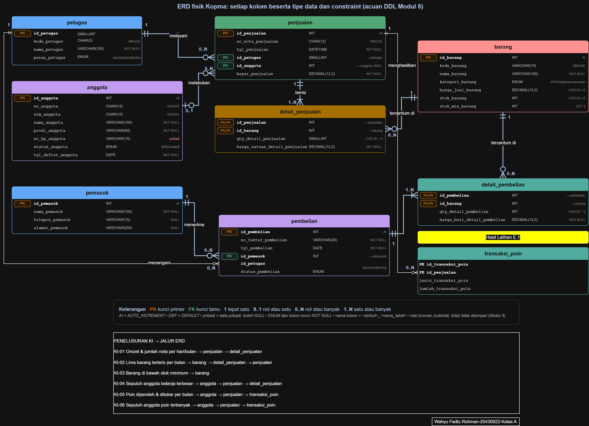
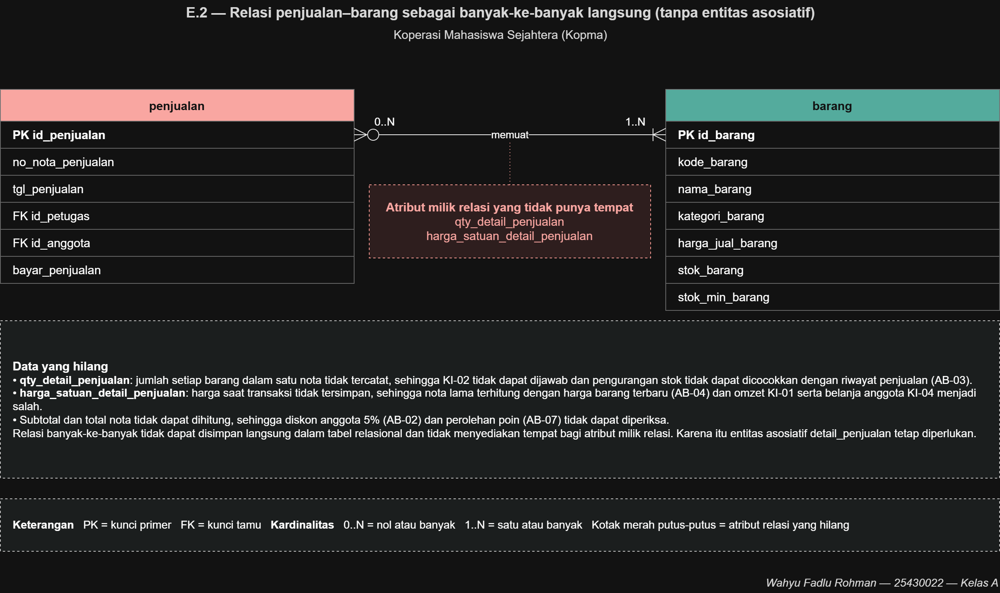

# Laporan Praktikum Basis Data - Pertemuan 02
**Nama:** Wahyu Fadlu Rohman **NIM:** 25430022 **Kelas:** A **Tanggal:** (12/10/2026)
**Dosen:** (Dedi Irawan, S.Kom.,M.T.I)

## 1. Tujuan Praktikum
Pada pertemuan ini saya belajar:
1. mengenali entitas, atribut, dan kunci dari dokumen kebutuhan data (p02);
2. menentukan relasi beserta kardinalitas dan partisipasinya, dengan alasan dari aturan bisnis (AB);
3. memecah relasi banyak-ke-banyak menjadi entitas asosiatif;
4. menggambar ERD notasi Crow's Foot di draw.io, lalu menguji ERD terhadap kebutuhan informasi (KI).
## 2. Ringkasan Dasar Teori
- **ERD** adalah hasil desain konseptual: menggambarkan entitas (hal yang dicatat), atribut (sifat entitas), dan relasi (hubungan antarentitas, dibaca sebagai kata kerja). Tipe data dan DBMS belum dipikirkan.
- **Kunci**: kunci primer (PK) membedakan setiap baris; kunci alternatif (UQ) juga unik tetapi tidak dipilih sebagai PK; kunci tamu (FK) merujuk ke PK entitas lain. **Atribut turunan** dapat dihitung dari atribut lain.
- **Kardinalitas** = berapa banyak paling banyak; **partisipasi** = wajib atau boleh tidak ada. Pada Crow's Foot, simbol yang dekat kotak entitas menyatakan maksimum, simbol yang lebih jauh menyatakan minimum. Label yang dipakai: 1, 0..1, 0..N, 1..N. Setiap ujung garis harus bisa ditelusuri ke aturan bisnis.
- **Banyak-ke-banyak** tidak dapat disimpan langsung dalam tabel relasional dan sering punya atribut sendiri, sehingga dipecah menjadi **entitas asosiatif** yang berelasi satu-ke-banyak dengan kedua entitas asalnya.
## 3. Hasil Langkah Percobaan
### D.1 Dari entitas kandidat ke entitas (Kopma)
Entitas Kopma yang dihasilkan (8 entitas): anggota, petugas, barang, pemasok, penjualan, detail_penjualan, pembelian, detail_pembelian.
| Entitas | Kunci primer | Kunci alternatif | Kunci tamu | Atribut turunan (tidak disimpan) |
|---|---|---|---|---|
| anggota | id_anggota | no_anggota, nim_anggota | - | - |
| petugas | id_petugas | kode_petugas | - | - |
| barang | id_barang | kode_barang | - | - |
| pemasok | id_pemasok | - | - | - |
| penjualan | id_penjualan | no_nota_penjualan | id_petugas, id_anggota | subtotal dan total nota |
| detail_penjualan | (id_penjualan, id_barang) | - | id_penjualan, id_barang | subtotal baris |
| pembelian | id_pembelian | no_faktur_pembelian | id_pemasok, id_petugas | total faktur |
| detail_pembelian | (id_pembelian, id_barang) | - | id_pembelian, id_barang | subtotal baris |

Langkah 2: entitas kandidat "Pembelian dan detailnya" dipecah menjadi `pembelian` dan `detail_pembelian` dengan pola yang sama seperti `penjualan` dan `detail_penjualan`.
### D.2 Relasi dan kardinalitas (Kopma)
| Relasi | Sisi kiri | Sisi kanan | Dasar |
|---|---|---|---|
| petugas melayani penjualan | tepat satu petugas | nol atau banyak penjualan | wawancara kasir |
| anggota melakukan penjualan | nol atau satu anggota | nol atau banyak penjualan | AB-02 |
| penjualan berisi detail_penjualan | tepat satu penjualan | satu atau banyak detail | AB-01 |
| barang tercantum di detail_penjualan | tepat satu barang | nol atau banyak detail | AB-04 |
| pemasok menerima pembelian | tepat satu pemasok | nol atau banyak pembelian | AB-06 |
| pembelian berisi detail_pembelian | tepat satu pembelian | satu atau banyak detail | faktur pemasok |
| barang tercantum di detail_pembelian | tepat satu barang | nol atau banyak detail | faktur pemasok |
| petugas menangani pembelian | tepat satu petugas | nol atau banyak pembelian | **[ISI: kode AB baru, lihat Titik Analisis 3]** |
| penjualan menghasilkan transaksi_poin (Latihan E.1) | tepat satu penjualan | nol atau banyak transaksi_poin | AB-07 |
### D.3 Menggambar ERD Kopma

Pemeriksaan terhadap standar kelengkapan (Tabel 3.3):
| Unsur | Ketentuan | Terpenuhi |
|---|---|---|
| Entitas | nama huruf kecil tunggal, satu warna per entitas | ☑ |
| Atribut | semua atribut dari kamus data tercantum | ☑ |
| Kunci | label PK, FK, PK,FK | ☑ |
| Kardinalitas | simbol Crow's Foot + label 1, 0..1, 0..N, 1..N di kedua ujung | ☑ |
| Garis relasi | dari PK ke FK, tidak saling menumpuk | **[ISI: periksa lagi, ada garis petugas yang berpotongan]** |
| Keterangan | kotak legenda di bawah diagram | ☑ |
### D.4 Validasi ERD terhadap KI (Kopma)
| KI | Kebutuhan informasi | Jalur ERD |
|---|---|---|
| KI-01 | Omzet dan jumlah nota per hari/bulan | penjualan → detail_penjualan |
| KI-02 | Lima barang terlaris per bulan | barang → detail_penjualan → penjualan |
| KI-03 | Barang di bawah stok minimum | barang |
| KI-04 | Sepuluh anggota belanja terbesar | anggota → penjualan → detail_penjualan |
| KI-05 | Poin diperoleh dan ditukar per bulan | anggota → penjualan → transaksi_poin |
| KI-06 | Sepuluh anggota poin terbanyak | anggota → penjualan → transaksi_poin |
Semua KI dapat ditelusuri, jadi tidak ada entitas atau relasi yang kurang.
## 4. Jawaban Titik Analisis
**Titik Analisis 1: mengapa id_anggota, bukan NIM, yang menjadi PK?**
`no_anggota` dan `nim_anggota` memang sama-sama unik, tetapi keduanya data bisnis yang nilainya bisa berubah atau salah ketik. Surrogate key `id_anggota` (integer, auto increment) tidak pernah berubah, kecil, dan ringan dipakai sebagai FK. Risiko jika NIM dijadikan PK: bila NIM perlu dikoreksi, semua FK di tabel lain (misalnya penjualan) ikut harus diubah, dan NIM yang panjang serta bersifat identitas pribadi tersebar ke banyak tabel. Keunikan NIM tetap dijaga lewat kunci alternatif (UNIQUE).
**Titik Analisis 2: mengapa penjualan ke detail_penjualan bernilai 1..N?**
Dipaksa oleh **AB-01**: setiap nota wajib memuat minimal satu barang, sehingga nota tanpa isi tidak sah. Aturan "minimal satu" **tidak dapat dijaga oleh struktur tabel saja**. FK hanya menjamin detail merujuk ke nota yang ada, tetapi tidak menjamin sebuah nota pasti punya detail (nota bisa tersimpan dulu, detail menyusul atau gagal). Menjaganya perlu transaksi (header dan detail disimpan bersama atau dibatalkan bersama), yang dibahas di Modul 14.
**Titik Analisis 3: "petugas gudang mana yang menerima barang dari pemasok?"**
ERD saat ini **sudah dapat menjawab**, lewat relasi *petugas menangani pembelian* (FK `id_petugas` di `pembelian`). Jalurnya: petugas → pembelian → pemasok, dengan menyaring `peran_petugas` = gudang. Keputusan ini sebaiknya **dicatat sebagai aturan bisnis baru** (mis. "setiap pembelian dicatat oleh satu petugas yang menangani penerimaan barang") agar kardinalitas sisi petugas punya dasar yang bisa ditelusuri. Kode: **[ISI: AB berikutnya di dokumen Kopma]**.
## 5. Hasil Latihan dan Modifikasi
### Latihan E.1: poin loyalitas pada ERD Kopma

**Keputusan: dibuat entitas riwayat `transaksi_poin`**, bukan sekadar atribut saldo di anggota. Alasan: KI-05 meminta poin yang *diperoleh dan ditukar per bulan*, dan KI-06 meminta peringkat poin. Atribut saldo tunggal hanya menyimpan nilai akhir, sehingga riwayat per bulan hilang dan saldo tidak dapat diaudit. Dengan riwayat, saldo cukup dihitung dari penjumlahan transaksi (konsisten dengan prinsip nilai turunan tidak disimpan). Relasi: satu penjualan menghasilkan nol atau banyak `transaksi_poin` (AB-07), dengan atribut `jenis_transaksi_poin` dan `jumlah_transaksi_poin`.
### Latihan E.2: penjualan-barang sebagai banyak-ke-banyak langsung

Data yang hilang bila tanpa entitas asosiatif:
- `qty_detail_penjualan`: jumlah tiap barang per nota tidak tercatat, sehingga KI-02 tidak dapat dijawab dan pengurangan stok tidak dapat dicocokkan (AB-03);
- `harga_satuan_detail_penjualan`: harga saat transaksi tidak tersimpan, sehingga nota lama terhitung dengan harga terbaru (AB-04) dan omzet KI-01 serta belanja anggota KI-04 menjadi salah;
- subtotal dan total nota tidak dapat dihitung, sehingga diskon anggota 5% dan perolehan poin (AB-07) tidak dapat diperiksa.
Relasi banyak-ke-banyak juga tidak bisa disimpan langsung di tabel relasional dan tidak menyediakan tempat bagi atribut milik relasi, sehingga `detail_penjualan` tetap diperlukan.
## 6. Tugas Mandiri: Milestone Proyek 03
Proyek: **Perpustakaan Cendekia WFR** (dokumen sumber: `p02_kebutuhan_data_25430022.md`).
Berkas: `p03_erd_25430022.drawio` dan `p03_erd_25430022.png`

### 6.1 Entitas, kunci, dan pemetaan ke PB/KI
| Entitas | PK | UQ | FK | Turunan | Proses (CRUD, p02) | KI terkait |
|---|---|---|---|---|---|---|
| anggota | id_anggota | no_anggota, nim_anggota | - | - | PB-01 C; PB-02, PB-03 R | KI-03, 04, 05 |
| petugas | id_petugas | kode_petugas | - | - | PB-02, 03, 04 R | pendukung (AB-07) |
| buku | id_buku | kode_buku | - | - | PB-04 C; PB-02 R | KI-02, 04, 05 |
| eksemplar | id_eksemplar | no_eksemplar | id_buku | jumlah tersedia (dari status_eksemplar) | PB-04 C; PB-02, 03 U | KI-02, 04, 05 |
| peminjaman | id_peminjaman | no_slip_peminjaman | id_petugas, id_anggota | total eksemplar (hitung baris detail) | PB-02 C; PB-03 U | KI-01, 03, 04, 05 |
| detail_peminjaman (asosiatif) | (id_peminjaman, id_eksemplar) | - | id_peminjaman, id_eksemplar | denda_detail_peminjaman | PB-02 C; PB-03 (lihat bagian 7) | KI-01, 02, 04, 05 |
### 6.2 Relasi dan kardinalitas
| Relasi | Sisi kiri | Sisi kanan | Dasar |
|---|---|---|---|
| anggota melakukan peminjaman | tepat satu anggota | nol atau banyak peminjaman | PB-02, AB-02, AB-07 |
| petugas mencatat peminjaman | tepat satu petugas | nol atau banyak peminjaman | PB-02, AB-07 |
| peminjaman berisi detail_peminjaman | tepat satu peminjaman | satu atau banyak detail | AB-01 |
| eksemplar tercantum di detail_peminjaman | tepat satu eksemplar | nol atau banyak detail | PB-02, AB-08 |
| buku memiliki eksemplar | tepat satu buku | nol atau banyak eksemplar | PB-04, AB-03 |
Alasan pokok:
- Sisi anggota **tepat satu** (bukan 0..1 seperti di Kopma) karena AB-02: peminjaman hanya boleh dilakukan anggota aktif, jadi setiap slip pasti punya anggota.
- Sisi detail **1..N** karena AB-01 (slip minimal satu eksemplar). Batas maksimal 7 eksemplar per slip (AB-05) dan syarat anggota aktif (AB-02) tidak dapat dinyatakan dalam Crow's Foot, jadi dijaga sebagai aturan bisnis.
- Sisi eksemplar **nol atau banyak detail** karena satu eksemplar fisik dipinjam berkali-kali dari waktu ke waktu (statusnya bergantian dipinjam/tersedia, AB-08).
### 6.3 Entitas asosiatif
`detail_peminjaman` memecah relasi banyak-ke-banyak peminjaman-eksemplar dan memiliki atribut sendiri: `tgl_kembali_detail_peminjaman` (atribut baru, belum ada di p02) dan `denda_detail_peminjaman` (turunan). Karena yang dipinjam adalah *eksemplar fisik* (satu baris = satu unit), tidak diperlukan kolom `qty`; `qty_peminjaman` dan `total_eksemplar` di p02 setara dengan jumlah baris detail per slip.
### 6.4 Penelusuran KI → jalur ERD
| KI | Kebutuhan informasi | Jalur ERD |
|---|---|---|
| KI-01 | Rekap peminjaman dan pengembalian harian/bulanan | peminjaman (tgl_peminjaman) → detail_peminjaman (tgl_kembali_detail_peminjaman) |
| KI-02 | Lima judul buku paling sering dipinjam per bulan | peminjaman → detail_peminjaman → eksemplar → buku |
| KI-03 | Anggota paling aktif meminjam | anggota → peminjaman |
| KI-04 | Buku yang melewati jatuh tempo dan belum kembali | anggota → peminjaman → detail_peminjaman → eksemplar → buku |
| KI-05 | Riwayat peminjaman berdasarkan NIM atau no. anggota | anggota → peminjaman → detail_peminjaman → eksemplar → buku |
### 6.5 Pemeriksaan standar kelengkapan (Tabel 3.3)
| Unsur | Terpenuhi | Bukti pada gambar |
|---|---|---|
| Entitas: huruf kecil tunggal, satu warna per entitas | ☑ | 6 kotak berwarna berbeda |
| Atribut: semua dari kamus data | ☑ | termasuk tgl_daftar_anggota, harga_buku, kondisi_eksemplar |
| Kunci: PK, FK, PK,FK, UQ | ☑ | detail_peminjaman memakai PK,FK komposit |
| Kardinalitas: Crow's Foot + label angka | ☑ | 1, 0..N, 1..N di kedua ujung |
| Garis relasi: PK ke FK, tidak menumpuk | ☑ | **[ISI: periksa ulang]** |
| Keterangan: legenda di bawah diagram | ☑ | legenda, perhitungan denda, penelusuran KI |
| Tanda tangan digital (nama + NIM) | ☑ | pojok kanan bawah |
### 6.6 Catatan tinjauan klien
CATATAN TINJAUAN KLIEN (diisi dari tinjauan teman sekelas yang berperan sebagai kepala perpustakaan).
Peninjau: Arya Yoga Pratama - 25430016
Tanggal tinjauan: 10 Oktober 2026
Umpan balik: Garis penghubung antara petugas dan denda agak mepet ke pinggir, jadi sedikit susah dibaca. Mungkin bisa digeser sedikit supaya lebih jelas.
Keputusan: diterima, alasannya memang benar setelah saya amati dan saya cek garis penghubung antara Petugas dan Denda terlalu mepet ke pinggir.
Umpan balik: Atribut hari_terlambat masih sedikit membingungkan karena cara menghitungnya belum jelas. Sebaiknya dijelaskan saat buku sudah dikembalikan maupun saat masih dipinjam.
Keputusan: diterima — Alasan: Masukan ini benar karena cara menghitung hari keterlambatan perlu dijelaskan supaya perhitungan denda tidak membingungkan.
## 7 Pembahasan dan Kendala
1. **Denda: disimpan atau dihitung?** `denda_detail_peminjaman` tertulis di kamus data p02 sebagai kolom tersimpan, sedangkan di ERD ditandai turunan (denda = tarif × hari terlambat, AB-06 dengan P = 5, yaitu Rp5.000 per hari per eksemplar). Denda hanya terbentuk saat pengembalian (PB-03); keterlambatan buku yang belum kembali (KI-04) dihitung saat kueri. Keputusan final disimpan atau dihitung ditunda ke Modul 4.
2. **Revisi p02.** Matriks CRUD p02 menandai PB-03 sebagai R pada Detail Peminjaman, padahal tanggal kembali dan denda tersimpan di detail, sehingga seharusnya **U**. Atribut `tgl_kembali_detail_peminjaman` juga belum ada di kamus data. Perubahan ini dicatat di commit, bukan diubah diam-diam.
3. **Aturan yang tidak tergambar.** AB-05 (maks. 7 eksemplar) dan AB-02 (anggota aktif) tidak dapat dinyatakan dalam notasi Crow's Foot; AB-03 (stok tidak negatif) ditangani dengan menghitung ketersediaan dari `status_eksemplar`, bukan kolom stok.
4. **Kendala tata letak.** **[ISI: mis. garis relasi berpotongan atau label kardinalitas bertumpuk di draw.io, dan cara mengatasinya]**
## 8. Kesimpulan
ERD mengubah daftar kebutuhan data menjadi gambar yang dapat dibaca bersama, dengan setiap kardinalitas berdasar aturan bisnis. Entitas asosiatif seperti detail_peminjaman diperlukan untuk menyimpan atribut milik relasi, dan validasi terhadap KI memastikan tidak ada kebutuhan informasi yang tidak dapat dijawab.
## 9. Pernyataan Penggunaan AI
Alat: Claude (Anthropic)
Dalam penyusunan laporan ini, saya menggunakan Claude (Anthropic) sebagai alat bantu untuk menyusun kerangka laporan berdasarkan struktur baku buku, serta membantu menyusun draf narasi berdasarkan ERD, dokumen PO2, dan hasil latihan yang telah saya kerjakan sendiri.
Bagian yang dibantu oleh AI meliputi penyusunan kerangka laporan dan draf narasi pada bagian 3 sampai 7. Sementara itu, pembuatan dan penyuntingan ERD dalam format .drawio dan .png, pengambilan keputusan desain, serta tinjauan klien saya kerjakan sendiri.
Bagian yang dibantu oleh AI meliputi penyusunan kerangka laporan dan draf narasi pada bagian 3 sampai 7. Sementara itu, pembuatan dan penyuntingan ERD dalam format .drawio dan .png.
## 10. Bukti Git
- Repositori: **[https://github.com/whyfadlurohman-lab/basisdata-25430022]**
- Commit ERD Kopma: `p03: latihan e erd kopma`, hash **[df89279]**
- Commit ERD proyek: `p03: milestone proyek 3`, hash **[952ce3e]**
- Commit gambar ERD: `p03: tambah gambar ERD dan latihan`, hash **[0710d21]**
- Commit laporan: `p03: revisi laporan dan gambar`, hash **[7b3186a]**

## Checklist
**Tabel 3.4 Checklist khusus laporan Pertemuan 3**
| Status | Jenis | Yang harus ada |
|:---:|---|---|
| ✅ | Berkas wajib | `p03_erd_kopma_<NIM>` dan `p03_erd_<NIM>` (gambar + berkas sumber diagram) |
| ✅ | Bukti tangkapan layar | ERD di draw.io dengan kardinalitas terbaca; catatan tinjauan klien |
| ✅ | Analisis wajib | Pemetaan setiap entitas ke PB/KI dari Pertemuan 2; alasan kardinalitas relasi utama |

**Tabel P.13 Checklist umum laporan praktikum**
| Status | Butir | Yang harus ada |
|:---:|---|---|
| ✅ | Identitas | Nama, NIM, kelas, pertemuan ke-N, tanggal pelaksanaan, nama asisten/dosen |
| ✅ | Tujuan | Tujuan praktikum ditulis ulang dengan bahasa sendiri (maksimal 5 baris) |
| ✅ | Ringkasan teori | Pemahaman sendiri atas Dasar Teori, maksimal setengah halaman, tanpa menyalin buku |
| ✅ | Langkah percobaan (D) | Tangkapan layar hasil langkah kunci sesuai checklist khusus, masing-masing diberi keterangan singkat |
| ✅ | Titik Analisis | Semua Titik Analisis dijawab lengkap dengan alasan, bukan sekadar ya/tidak |
| ✅ | Latihan (E) | Skrip/dokumen hasil latihan beserta bukti berjalan |
| ✅ | Tugas Mandiri (F) | Milestone proyek pertemuan ini: berkas, bukti, dan penjelasan keputusan desain |
| ✅ | Pembahasan dan kendala | Galat yang ditemui, cara membacanya, dan cara mengatasinya |
| ✅ | Kesimpulan | Dua sampai empat kalimat dengan bahasa sendiri |
| ✅ | Pernyataan Penggunaan AI | Alat yang dipakai, untuk apa, bagian mana; tulis "tidak menggunakan" bila tidak memakai |
| ✅ | Bukti Git | Tautan repositori dan kode commit (hash) pertemuan ini dengan pesan pNN: ... |
| ✅ | Keaslian | Setiap tangkapan layar memperlihatkan akun ber-NIM dan jam sistem; nama objek memuat NIM/inisial |