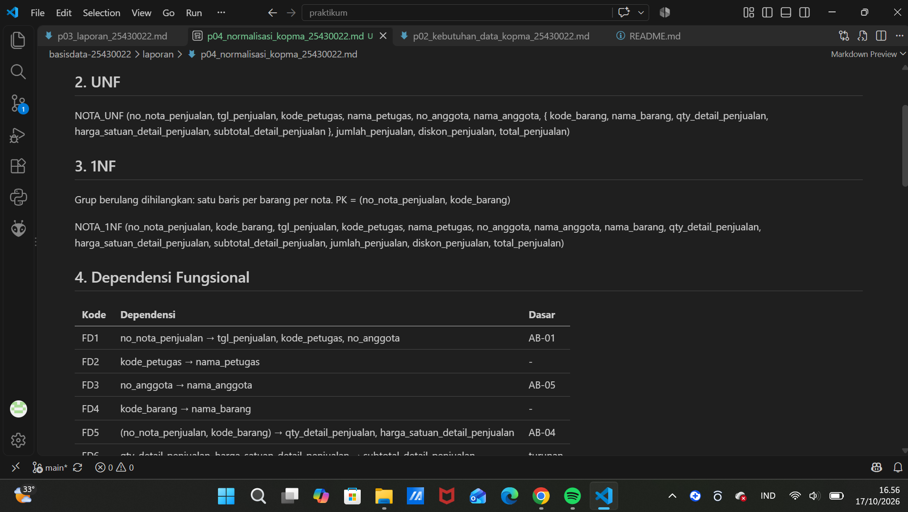
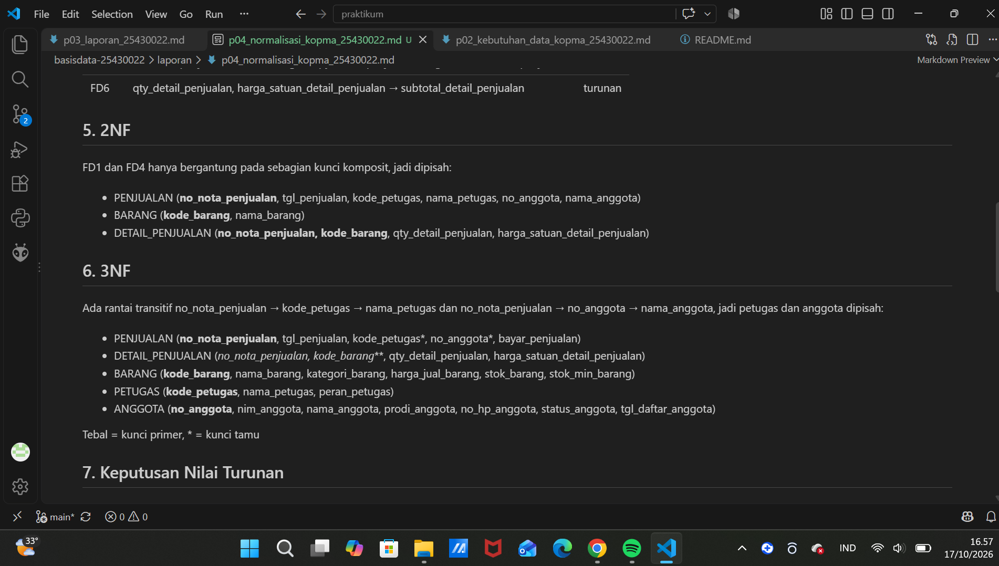
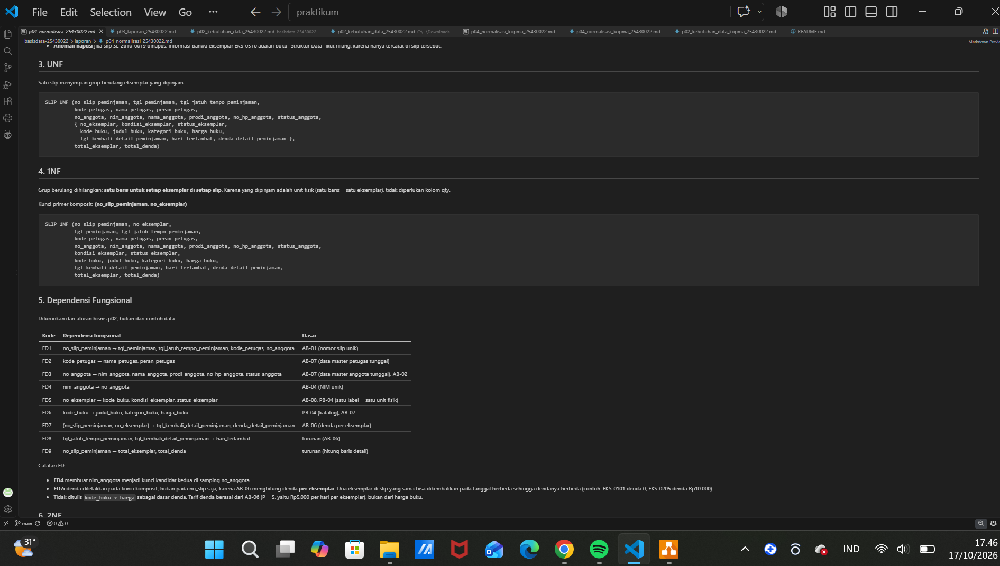
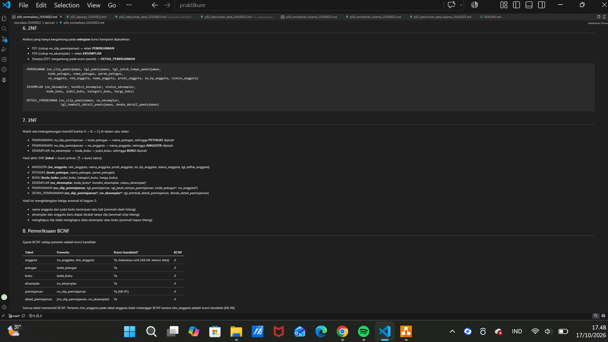
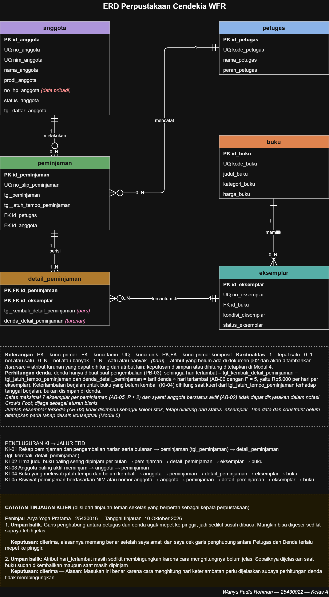

# Laporan Praktikum Basis Data - Pertemuan 04
**Nama:** Wahyu Fadlu Rohman **NIM:** 25430022 **Kelas:** A **Tanggal:** (isi tanggal praktikum)
**Dosen:** (Dedi Irawan, S.Kom.,M.T.I)

## 1. Tujuan Praktikum
Pada pertemuan ini saya belajar:
1. mengenali anomali ubah, sisip, dan hapus pada data yang belum dinormalisasi;
2. menuliskan dependensi fungsional (FD) berdasarkan aturan bisnis, bukan berdasarkan contoh data;
3. menormalisasi relasi dari UNF sampai 3NF, lalu memeriksa BCNF;
4. memutuskan nilai turunan mana yang disimpan dan mana yang dihitung, lalu mendokumentasikan skema relasional akhir.

## 2. Ringkasan Dasar Teori
- **Anomali** muncul jika banyak fakta disimpan berulang dalam satu tabel besar. Anomali ubah terjadi ketika satu fakta tertulis di banyak baris sehingga bisa tidak konsisten. Anomali sisip terjadi ketika fakta tidak bisa dicatat sebelum ada fakta lain. Anomali hapus terjadi ketika menghapus satu fakta ikut menghilangkan fakta lain.
- **Dependensi fungsional** A → B berarti satu nilai A selalu menentukan tepat satu nilai B. FD diturunkan dari aturan bisnis (AB-xx). Contoh data hanya bisa membantah FD, tidak bisa membuktikannya.
- **Bentuk normal:**
  - 1NF: semua nilai atomik dan tidak ada grup berulang.
  - 2NF: tidak ada atribut yang bergantung hanya pada sebagian kunci komposit.
  - 3NF: tidak ada rantai A → B → C di dalam satu tabel.
  - BCNF: setiap penentu adalah kunci kandidat.
- **Nilai turunan** (subtotal, total, dan sejenisnya) sebaiknya dihitung agar tidak bisa tidak konsisten. Pengecualiannya adalah nilai yang merupakan potret historis, yang harus disimpan.
- **Kunci pengganti** (`id_*`) tidak menggantikan normalisasi. Dependensi tetap diperiksa dengan kunci alami.

## 3. Hasil Langkah Percobaan
Berkas: `p04_normalisasi_kopma_25430022.md`

### D.1 UNF ke 1NF (Kopma)
Spreadsheet lama Kopma memiliki grup berulang barang di setiap nota. Grup itu dipecah sehingga satu baris berisi satu barang per nota, dengan kunci komposit (no_nota_penjualan, kode_barang).



### D.2 Dependensi fungsional (Kopma)
| Kode | Dependensi | Dasar |
|---|---|---|
| FD1 | no_nota_penjualan → tgl_penjualan, kode_petugas, no_anggota | AB-01 |
| FD2 | kode_petugas → nama_petugas | - |
| FD3 | no_anggota → nama_anggota | AB-05 |
| FD4 | kode_barang → nama_barang | - |
| FD5 | (no_nota_penjualan, kode_barang) → qty_detail_penjualan, harga_satuan_detail_penjualan | AB-04 |
| FD6 | qty_detail_penjualan, harga_satuan_detail_penjualan → subtotal_detail_penjualan | turunan |

### D.3 2NF dan 3NF (Kopma)
- **2NF:** FD1 dan FD4 hanya bergantung pada sebagian kunci, jadi dipisah menjadi penjualan dan barang. Sisanya menjadi detail_penjualan.
- **3NF:** rantai no_nota → kode_petugas → nama_petugas dan no_nota → no_anggota → nama_anggota dipisah menjadi petugas dan anggota.
- **Nilai turunan:** subtotal, jumlah, dan total tidak disimpan.



### D.4 Pencocokan dengan skema kanonik dan pemeriksaan BCNF (Kopma)
Hasil saya sama dengan Tabel 4.2. Perbedaannya hanya pada kunci pengganti `id_*` yang dipakai sebagai kunci primer, sedangkan kode alami (no_nota_penjualan, kode_barang, kode_petugas, no_anggota, nim_anggota) menjadi kunci unik.

| Tabel | Penentu | Kunci kandidat? | BCNF |
|---|---|---|---|
| petugas | kode_petugas | Ya | ✔ |
| anggota | no_anggota, nim_anggota | Ya, keduanya unik (AB-05) | ✔ |
| barang | kode_barang | Ya | ✔ |
| penjualan | no_nota_penjualan | Ya | ✔ |
| detail_penjualan | (no_nota_penjualan, kode_barang) | Ya | ✔ |

Tidak ada penentu yang bukan kunci kandidat, jadi semua tabel Kopma memenuhi BCNF.

## 4. Jawaban Titik Analisis
**Titik Analisis 1: mengapa harga_satuan_detail_penjualan bergantung pada (no_nota_penjualan, kode_barang), bukan pada kode_barang saja?**
Menurut AB-04, harga yang tercetak di nota tidak boleh berubah walaupun harga barang kemudian naik. Artinya, barang yang sama bisa punya harga berbeda di nota yang berbeda. Jadi harga ditentukan oleh pasangan nota dan barang, bukan oleh barangnya saja. Kalau harga dipindah ke tabel barang, setiap kenaikan harga akan ikut mengubah semua nota lama. Akibatnya laporan omzet tahun lalu dihitung ulang dengan harga terbaru dan hasilnya salah, lebih besar dari uang yang benar-benar diterima.

**Titik Analisis 2: mengapa keputusan "total tidak disimpan" tetap konsisten dengan tabel arsip yang menyimpan total?**
Tabel operasional berisi data yang masih bisa berubah, misalnya detail nota yang dikoreksi. Kalau total ikut disimpan di sana, total bisa tidak cocok dengan detailnya, jadi lebih aman dihitung. Tabel arsip berisi potret historis yang sudah dibekukan dan tidak boleh berubah lagi, sehingga menyimpan total di arsip justru menjaga laporan lama tetap sama. Kedua keputusan memakai prinsip yang sama: nilai disimpan hanya jika memang harus dibekukan.

**Titik Analisis 3: ke mana informasi "barang ini dipasok oleh siapa" (kolom pemasok_brg)?**
Informasi itu sekarang tersimpan melalui tabel **pembelian** (yang punya FK id_pemasok) dan **detail_pembelian** (yang menghubungkan pembelian dengan id_barang). Jalurnya: barang → detail_pembelian → pembelian → pemasok. Cara ini punya dua keuntungan dibanding satu kolom nama pemasok di tabel barang. Pertama, satu barang bisa dipasok oleh banyak pemasok, dan riwayatnya tercatat lengkap dengan tanggal. Kedua, nama pemasok hanya ditulis sekali di tabel pemasok, sehingga ejaan seperti "CV Sumber ATK" dan "CV. Sumber A.T.K" tidak bisa berbeda lagi.

## 5. Hasil Latihan dan Modifikasi
### Latihan E.1: beberapa nomor telepon untuk setiap pemasok
Jika nomor telepon disimpan sebagai `telp1, telp2, ...` atau sebagai daftar dalam satu sel, relasinya melanggar 1NF karena ada grup berulang atau nilai yang tidak atomik. Grup berulang itu dipisah ke relasi baru:

```
PEMASOK (id_pemasok, nama_pemasok, alamat_pemasok)
TELEPON_PEMASOK (id_pemasok*, no_telepon_pemasok, jenis_telepon_pemasok)
```
- Kunci primer TELEPON_PEMASOK adalah (id_pemasok, no_telepon_pemasok), dan id_pemasok merujuk ke pemasok.
- FD: (id_pemasok, no_telepon_pemasok) → jenis_telepon_pemasok. Relasi ini memenuhi 3NF dan BCNF.
- Satu pemasok bisa punya nol atau banyak nomor telepon tanpa perlu menambah kolom.

### Latihan E.2: nama_anggota disimpan di tabel penjualan
Contoh data yang melanggar 3NF, karena ada rantai no_nota_penjualan → no_anggota → nama_anggota:

| no_nota_penjualan | tgl_penjualan | no_anggota | nama_anggota |
|---|---|---|---|
| PJ-0142 | 2026-09-24 | A-0007 | Budi Santoso |
| PJ-0150 | 2026-09-25 | A-0007 | Budi Santoso |
| PJ-0161 | 2026-09-27 | A-0007 | Budi Santoso |

Kueri ubah yang memperlihatkan anomali ubah:
```sql
UPDATE penjualan
SET nama_anggota = 'Budi Santoso Putra'
WHERE no_nota_penjualan = 'PJ-0142';
```
Setelah kueri ini dijalankan, anggota A-0007 punya dua nama berbeda: "Budi Santoso Putra" di PJ-0142 dan "Budi Santoso" di PJ-0150 dan PJ-0161. Supaya konsisten, semua baris milik A-0007 harus ikut diubah. Pada desain 3NF, nama hanya disimpan sekali di tabel anggota, jadi cukup satu perubahan:
```sql
UPDATE anggota
SET nama_anggota = 'Budi Santoso Putra'
WHERE no_anggota = 'A-0007';
```

## 6. Tugas Mandiri: Milestone Proyek 04
Proyek: **Perpustakaan Cendekia WFR** (tema perpus, P = 5)
Berkas: `p04_normalisasi_25430022.md`

### 6.1 Dokumen sumber dan anomali
Titik awal UNF adalah **Slip Peminjaman Buku** dari p02 bagian 3. Jika slip disalin mentah ke satu tabel, muncul tiga anomali:
- **ubah:** nama anggota dan judul buku ditulis berbeda di slip yang berbeda;
- **sisip:** eksemplar baru tidak bisa dicatat sebelum dipinjam;
- **hapus:** menghapus slip ikut menghapus informasi buku dari eksemplar yang hanya tercatat di slip itu.

### 6.2 UNF, 1NF, dan dependensi fungsional
Grup berulang eksemplar dipecah sehingga satu baris berisi satu eksemplar per slip. Kunci 1NF adalah (no_slip_peminjaman, no_eksemplar). Kolom qty tidak diperlukan karena satu baris sudah sama dengan satu unit fisik.



| Kode | Dependensi fungsional | Dasar |
|---|---|---|
| FD1 | no_slip_peminjaman → tgl_peminjaman, tgl_jatuh_tempo_peminjaman, kode_petugas, no_anggota | AB-01 |
| FD2 | kode_petugas → nama_petugas, peran_petugas | AB-07 |
| FD3 | no_anggota → nim_anggota, nama_anggota, prodi_anggota, no_hp_anggota, status_anggota | AB-07, AB-02 |
| FD4 | nim_anggota → no_anggota | AB-04 |
| FD5 | no_eksemplar → kode_buku, kondisi_eksemplar, status_eksemplar | AB-08, PB-04 |
| FD6 | kode_buku → judul_buku, kategori_buku, harga_buku | PB-04, AB-07 |
| FD7 | (no_slip_peminjaman, no_eksemplar) → tgl_kembali_detail_peminjaman, denda_detail_peminjaman | AB-06 |
| FD8 | tgl_jatuh_tempo_peminjaman, tgl_kembali_detail_peminjaman → hari_terlambat | turunan (AB-06) |
| FD9 | no_slip_peminjaman → total_eksemplar, total_denda | turunan |

### 6.3 2NF, 3NF, dan BCNF
- **2NF:** FD1 hanya bergantung pada no_slip dan menjadi PEMINJAMAN. FD5 hanya bergantung pada no_eksemplar dan menjadi EKSEMPLAR. FD7 tetap di DETAIL_PEMINJAMAN.
- **3NF:** rantai slip → kode_petugas → nama_petugas, slip → no_anggota → nama_anggota, dan eksemplar → kode_buku → judul_buku dipisah menjadi PETUGAS, ANGGOTA, dan BUKU.
- **Hasil:** 6 tabel, yaitu anggota, petugas, buku, eksemplar, peminjaman, dan detail_peminjaman. Semuanya memenuhi BCNF karena setiap penentu adalah kunci kandidat. Pada tabel anggota, no_anggota dan nim_anggota sama-sama kunci kandidat (AB-04).



### 6.4 Keputusan nilai turunan
| Nilai | Keputusan | Alasan singkat |
|---|---|---|
| total_eksemplar | Dihitung | COUNT baris detail; batas 7 eksemplar (AB-05) diperiksa dari sini |
| eksemplar tersedia per buku | Dihitung | Dari status_eksemplar, sehingga tidak mungkin negatif (AB-03) |
| hari_terlambat | Dihitung | Selisih tanggal kembali (atau hari ini) dengan jatuh tempo |
| total_denda per slip | Dihitung | Penjumlahan denda per eksemplar |
| denda_detail_peminjaman | **Disimpan** | Potret saat pengembalian; tidak boleh berubah jika tarif AB-06 kelak diubah |
| tgl_jatuh_tempo_peminjaman | **Disimpan** | Lama pinjam adalah kebijakan yang bisa berubah, sedangkan batas di slip harus tetap |

### 6.5 Perubahan ERD dan p02
Jumlah entitas tetap 6, sama dengan ERD Modul 3. Perubahannya:
1. `denda_detail_peminjaman` diubah dari tanda (turunan) menjadi (disimpan);
2. legenda ERD menjelaskan cara hitung `hari_terlambat` untuk buku yang sudah kembali dan yang masih dipinjam, sesuai masukan tinjauan klien;
3. `tgl_kembali_detail_peminjaman` ditambahkan ke kamus data p02;
4. matriks CRUD PB-03 × Detail Peminjaman diubah dari R menjadi U;
5. `tgl_jatuh_tempo` di p02 diganti namanya menjadi `tgl_jatuh_tempo_peminjaman` agar sesuai standar penamaan dan ERD.



## 7. Pembahasan dan Kendala
1. **Denda: disimpan atau dihitung?** Di Modul 3 keputusan ini ditunda. Awalnya denda terlihat seperti nilai turunan, karena tarif dikali hari terlambat. Tetapi tarif denda (AB-06) bisa berubah. Kalau denda selalu dihitung ulang, denda lama akan ikut berubah. Karena itu denda saya simpan sebagai potret saat pengembalian, dengan alasan yang sama seperti harga satuan pada nota Kopma (AB-04). Sebaliknya, hari_terlambat tetap dihitung.
2. **Nama kolom tidak konsisten.** Saat mencocokkan p02 dengan ERD, saya menemukan `tgl_jatuh_tempo` di p02 tetapi `tgl_jatuh_tempo_peminjaman` di ERD. Saya memakai versi ERD karena sesuai standar penamaan (akhiran nama tabel), lalu memperbaiki p02.
3. **Godaan menebak FD dari contoh data.** Di contoh slip, setiap peminjaman berjatuh tempo 7 hari, sehingga seolah-olah tgl_peminjaman → tgl_jatuh_tempo. Karena tidak ada AB yang menetapkan aturan itu, FD tersebut tidak saya tulis, dan tanggal jatuh tempo tetap disimpan.
4. **Screenshot tidak muat satu layar.** Tampilan pratinjau VS Code saya perkecil dengan Ctrl + - supaya tahapan normalisasi muat dan jam Windows tetap terlihat.
5. **Gambar belum ikut ter-push.** Saat `git status`, dua gambar proyek masih berstatus *untracked*. Saya menambahkannya dengan `git add`, commit, lalu push ulang.

## 8. Kesimpulan
Normalisasi membuktikan bahwa ERD proyek Perpustakaan Cendekia WFR sudah bebas dari anomali ubah, sisip, dan hapus. Hasil 3NF menghasilkan 6 tabel yang sama dengan entitas ERD, dan semuanya memenuhi BCNF. Keputusan terpenting adalah menyimpan denda sebagai potret historis, sedangkan nilai turunan lain dihitung. Skema ini menjadi dasar skrip DDL pada Pertemuan 5.

## 9. Pernyataan Penggunaan AI
Alat: Claude (Anthropic)
Claude saya gunakan untuk membantu memahami langkah normalisasi pada buku, menyusun draf dokumen `p04_normalisasi_25430022.md` dan draf laporan ini berdasarkan dokumen p02 dan ERD proyek yang saya buat sendiri, serta merevisi berkas p02 dan ERD (.drawio) sesuai hasil normalisasi. Pengambilan screenshot, pengecekan isi, ekspor gambar ERD, dan pengumpulan melalui Git saya kerjakan sendiri.

## 10. Bukti Git
- Repositori: https://github.com/whyfadlurohman-lab/basisdata-25430022
- Commit normalisasi Kopma: `p04: normalisasi kopma`, hash **[isi hash]**
- Commit milestone proyek: `p04: milestone proyek 4 normalisasi`, hash **[isi hash]**
- Commit screenshot proyek: `p04: screenshot tahapan normalisasi proyek`, hash **[isi hash]**
- Commit revisi p02 dan ERD: `p04: revisi p02 dan ERD hasil normalisasi`, hash **[isi hash]**
- Commit laporan: `p04: laporan pertemuan 4`, hash **[isi hash]**

## Checklist
**Tabel 4.3 Checklist khusus laporan Pertemuan 4**
| Status | Jenis | Yang harus ada |
|:---:|---|---|
| ☐ | Berkas wajib | `p04_normalisasi_25430022.md` (proyek) |
| ☐ | Bukti tangkapan layar | Tabel tahapan UNF → 1NF → 2NF → 3NF |
| ☐ | Analisis wajib | Daftar dependensi fungsional; keputusan menyimpan atau menghitung nilai turunan beserta alasannya |

**Tabel P.13 Checklist umum laporan praktikum**
| Status | Butir | Yang harus ada |
|:---:|---|---|
| ☐ | Identitas | Nama, NIM, kelas, pertemuan ke-N, tanggal pelaksanaan, nama asisten/dosen |
| ☐ | Tujuan | Tujuan praktikum ditulis ulang dengan bahasa sendiri (maksimal 5 baris) |
| ☐ | Ringkasan teori | Pemahaman sendiri atas Dasar Teori, maksimal setengah halaman, tanpa menyalin buku |
| ☐ | Langkah percobaan (D) | Tangkapan layar hasil langkah kunci sesuai checklist khusus, masing-masing diberi keterangan singkat |
| ☐ | Titik Analisis | Semua Titik Analisis dijawab lengkap dengan alasan, bukan sekadar ya/tidak |
| ☐ | Latihan (E) | Skrip/dokumen hasil latihan beserta bukti berjalan |
| ☐ | Tugas Mandiri (F) | Milestone proyek pertemuan ini: berkas, bukti, dan penjelasan keputusan desain |
| ☐ | Pembahasan dan kendala | Galat yang ditemui, cara membacanya, dan cara mengatasinya |
| ☐ | Kesimpulan | Dua sampai empat kalimat dengan bahasa sendiri |
| ☐ | Pernyataan Penggunaan AI | Alat yang dipakai, untuk apa, bagian mana; tulis "tidak menggunakan" bila tidak memakai |
| ☐ | Bukti Git | Tautan repositori dan kode commit (hash) pertemuan ini dengan pesan pNN: ... |
| ☐ | Keaslian | Setiap tangkapan layar memperlihatkan akun ber-NIM dan jam sistem; nama objek memuat NIM/inisial |