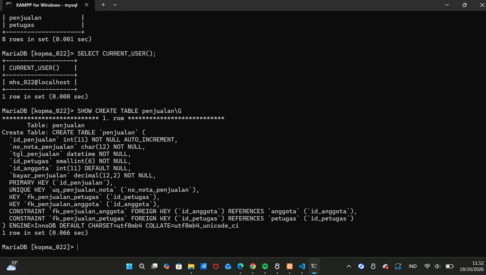
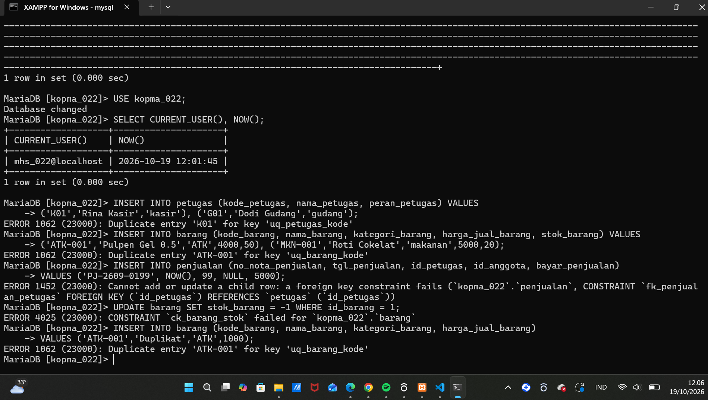
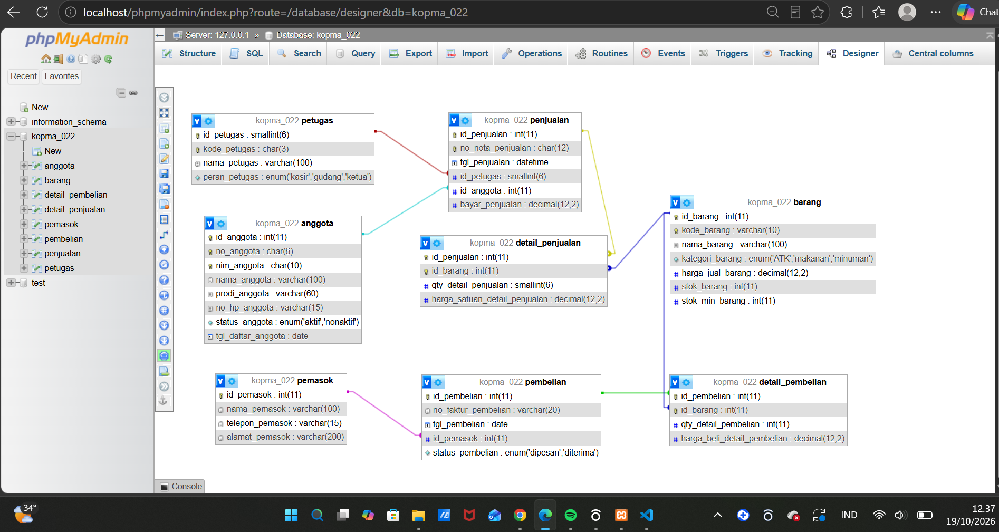
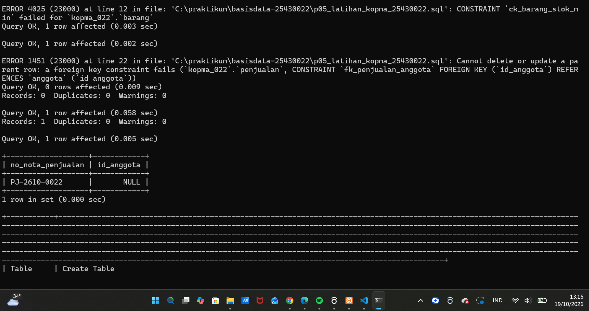
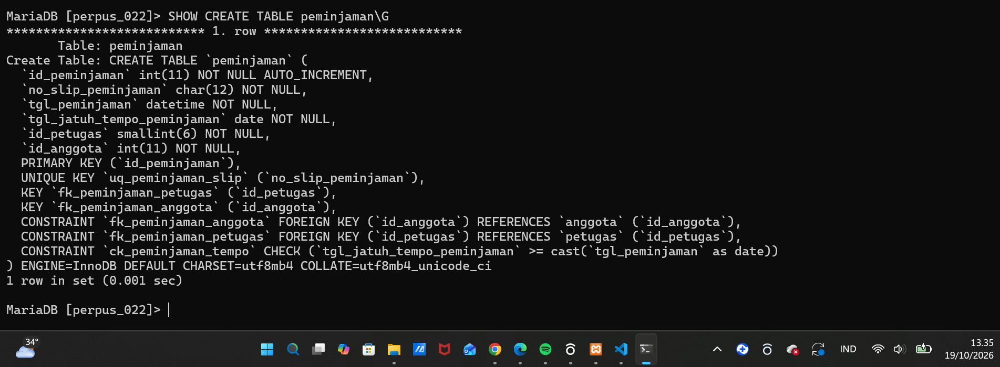
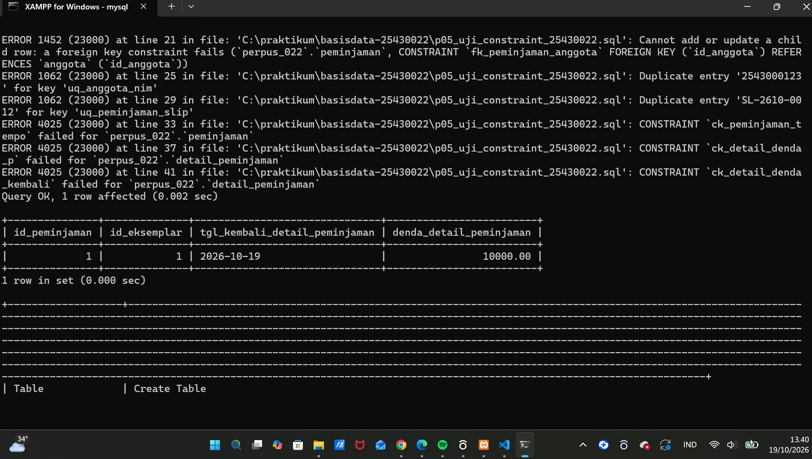
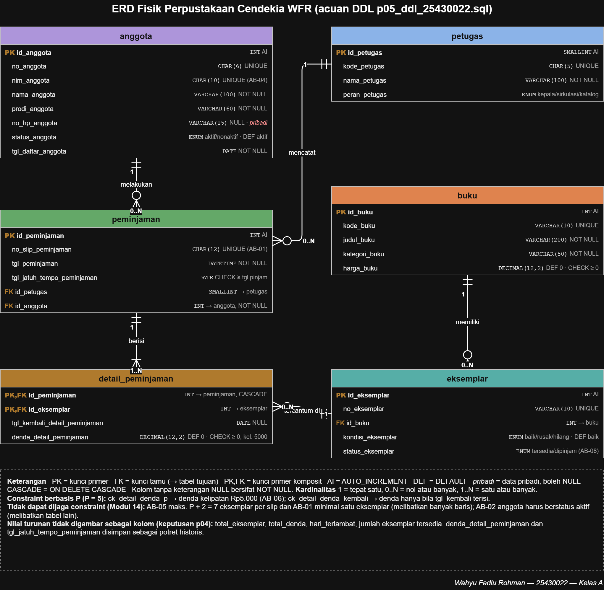
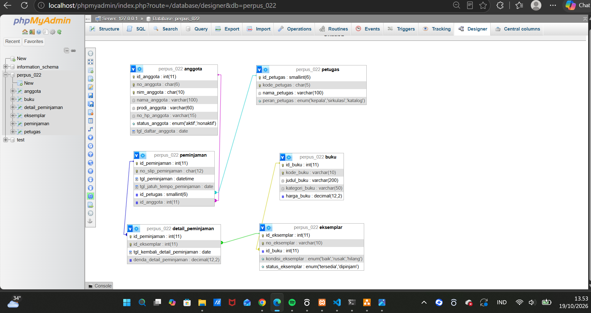

# Laporan Praktikum Basis Data - Pertemuan 05
**Nama:** Wahyu Fadlu Rohman **NIM:** 25430022 **Kelas:** A **Tanggal:** (19/10/2026)
**Dosen:** (Dedi Irawan, S.Kom.,M.T.I)

## 1. Tujuan Praktikum
Pada pertemuan ini saya belajar:
1. mengubah skema relasional 3NF menjadi perintah CREATE TABLE dengan tipe data yang tepat;
2. memasang constraint PRIMARY KEY, FOREIGN KEY, UNIQUE, NOT NULL, DEFAULT, dan CHECK berdasarkan aturan bisnis;
3. mengubah dan menghapus struktur tabel dengan ALTER TABLE dan DROP TABLE dalam urutan yang benar;
4. membuktikan bahwa server menolak data yang melanggar aturan, lalu membandingkan desain fisik dengan ERD.

## 2. Ringkasan Dasar Teori
Menurut pemahaman saya, DDL adalah kelompok perintah SQL yang khusus mengurus "bentuk" basis data, bukan isinya. Dengan CREATE saya membuat tabel, dengan ALTER saya mengubah tabel yang sudah ada (misalnya menambah kolom tgl_kedaluwarsa), dan dengan DROP saya menghapusnya.

Memilih tipe data ternyata tidak bisa asal. NIM dan nomor slip panjangnya selalu sama dan bukan angka untuk dihitung, jadi lebih cocok memakai CHAR. Harga dan denda harus memakai DECIMAL, karena FLOAT bisa membuat nilai uang meleset sedikit. Kolom yang pilihannya sudah pasti, seperti status anggota atau peran petugas, lebih aman memakai ENUM supaya isinya tidak bisa ditulis sembarangan.

Constraint saya pahami sebagai "penjaga" di sisi server. Aturan bisnis yang tadinya hanya tertulis di dokumen, sekarang langsung ditegakkan oleh MariaDB. PRIMARY KEY dan UNIQUE menolak data kembar, FOREIGN KEY menolak rujukan ke data yang tidak ada, dan CHECK menolak nilai yang tidak masuk akal seperti stok minus. Hal ini terbukti di praktikum, karena ketiga percobaan data salah langsung ditolak dengan kode galat 1452, 4025, dan 1062.

Urutan juga penting. Tabel induk harus dibuat lebih dulu daripada tabel anak, dan saat dihapus urutannya dibalik. Tipe kolom kunci tamu juga harus sama persis dengan kolom yang dirujuk. Terakhir, CHECK hanya bisa memeriksa satu baris. Jadi aturan seperti "maksimal 7 eksemplar per slip" tidak bisa dijaga dengan CHECK dan harus ditangani dengan transaksi nanti.

## 3. Hasil Langkah Percobaan
Berkas: `p05_ddl_kopma_25430022.sql` dan `p05_uji_constraint_kopma_25430022.sql`

### D.1 dan D.2 Membuat tabel induk dan tabel dengan kunci tamu
Delapan tabel Kopma dibuat dengan urutan petugas, anggota, barang, pemasok, penjualan, detail_penjualan, pembelian, lalu detail_pembelian. Skrip dijalankan dua kali berturut-turut tanpa galat, karena di awal skrip terdapat blok `DROP TABLE IF EXISTS` dengan urutan anak ke induk.



### D.3 Membuktikan constraint bekerja
Setelah data induk diisi (dua petugas dan dua barang), tiga perintah yang melanggar aturan semuanya ditolak server:

| Percobaan | Galat | Constraint |
|---|---|---|
| Nota dengan petugas 99 yang tidak ada | ERROR 1452 | fk_penjualan_petugas |
| Stok barang diubah menjadi -1 | ERROR 4025 | ck_barang_stok |
| Kode barang ATK-001 dimasukkan dua kali | ERROR 1062 | uq_barang_kode |



### D.4 Mengubah struktur dan membandingkan dengan ERD
Kolom `tgl_kedaluwarsa` berhasil ditambahkan dengan `ALTER TABLE barang ADD COLUMN`, lalu dihapus lagi dengan `DROP COLUMN` tanpa membuat ulang tabel.



Perbandingan Designer phpMyAdmin dengan ERD Kopma (Gambar 3.2):

| Unsur | ERD buku | Designer | Sama? |
|---|---|---|---|
| Jumlah tabel | 8 | 8 | ✔ |
| Nama dan tipe kolom | tercantum | tercantum, sesuai DDL | ✔ |
| Kunci primer dan kunci tamu | label PK dan FK | ikon kunci dan garis relasi | ✔ (beda tampilan) |
| Kardinalitas | notasi Crow's Foot | hanya garis | ✘ |
| UNIQUE, AUTO_INCREMENT, DEFAULT, CHECK | tercantum | tidak tampil | ✘ |
| Nilai ENUM | tercantum | tampil di tipe kolom | ✔ |
| Tanda data pribadi | ada | tidak ada | ✘ |

Struktur fisik (tabel, kolom, tipe, PK, dan FK) sama dengan ERD. Designer hanya menggambar struktur yang tersimpan di server, sehingga kardinalitas dan sebagian besar constraint tidak terlihat. Karena itu ERD fisik tetap diperlukan sebagai dokumentasi.

## 4. Jawaban Titik Analisis
**Titik Analisis 1: mengapa fk_detail_penjualan memakai ON DELETE CASCADE, sedangkan fk_detail_barang tidak?**
Baris detail penjualan tidak punya arti tanpa notanya. Jika sebuah nota dibatalkan, rinciannya memang harus ikut terhapus, sehingga CASCADE tepat dipakai. Sebaliknya, barang adalah data master yang dirujuk oleh banyak nota lama. Jika barang boleh dihapus beserta seluruh detailnya, baris penjualan masa lalu ikut hilang. Akibatnya laporan omzet (KI-01) dan barang terlaris (KI-02) untuk bulan-bulan sebelumnya berubah dan menjadi lebih kecil dari uang yang benar-benar diterima. Karena itu fk_detail_barang memakai aturan bawaan (RESTRICT). Server menolak menghapus barang yang pernah terjual.

**Titik Analisis 2: pemetaan kode galat ke aturan bisnis**

| Kode | Arti | Aturan bisnis yang dilindungi |
|---|---|---|
| 1452 | Kunci tamu merujuk data yang tidak ada | Setiap nota wajib punya kasir yang terdaftar (permintaan pengurus); AB-02 untuk sisi anggota |
| 4025 | CHECK dilanggar | AB-03 stok tidak boleh negatif |
| 1062 | Nilai kembar pada kunci unik | Kode barang unik; pola yang sama menjaga AB-01 (nomor nota unik) dan AB-05 (NIM unik) |

Aturan Kopma yang **belum** dapat dijaga oleh constraint apa pun:
- **AB-01 minimal satu barang per nota:** melibatkan keberadaan baris di tabel lain.
- **AB-02 diskon hanya untuk anggota aktif:** perlu membaca status di tabel anggota, dan CHECK tidak boleh merujuk tabel lain.
- **AB-03 bagian "penjualan ditolak bila qty melebihi stok":** membandingkan dua tabel.
- **AB-04 harga di nota sama dengan harga barang saat transaksi:** hanya benar pada saat transaksi terjadi.
- **AB-06 pemesanan otomatis saat stok di bawah minimum:** ini alur proses, bukan aturan satu baris.

Semua aturan ini harus dijaga dengan transaksi (Modul 14).

**Titik Analisis 3: mengapa DROP TABLE IF EXISTS dimulai dari detail_pembelian dan detail_penjualan?**
Tabel detail adalah anak yang merujuk ke penjualan, pembelian, dan barang. Selama tabel anak masih ada, server tidak mengizinkan tabel induknya dihapus. Kalau urutannya dibalik, misalnya `DROP TABLE petugas` dijalankan saat tabel penjualan masih ada, muncul galat:
`ERROR 1451 (23000): Cannot delete or update a parent row: a foreign key constraint fails`.
Jadi penghapusan harus berjalan dari anak ke induk, kebalikan dari urutan pembuatan.

## 5. Hasil Latihan dan Modifikasi
Berkas: `p05_latihan_kopma_25430022.sql`

### Latihan E.1: CHECK stok_min_barang tidak negatif
```sql
ALTER TABLE barang ADD CONSTRAINT ck_barang_stok_min CHECK (stok_min_barang >= 0);
UPDATE barang SET stok_min_barang = -3 WHERE id_barang = 1;
-- ERROR 4025: CONSTRAINT `ck_barang_stok_min` failed
```

### Latihan E.2: ON DELETE SET NULL pada fk_penjualan_anggota
```sql
ALTER TABLE penjualan DROP FOREIGN KEY fk_penjualan_anggota;
ALTER TABLE penjualan ADD CONSTRAINT fk_penjualan_anggota FOREIGN KEY (id_anggota)
  REFERENCES anggota (id_anggota) ON DELETE SET NULL;
```
- **Sebelum diubah:** menghapus anggota yang punya nota ditolak dengan ERROR 1451.
- **Sesudah diubah:** anggota berhasil dihapus, notanya tetap ada, dan `id_anggota` berubah menjadi NULL.



**Diskusi:**
- **Terhadap AB-02,** perubahan ini tidak melanggar struktur, karena AB-02 Kopma memang membolehkan nota tanpa anggota (pembeli umum). Tetapi riwayat belanja anggota tersebut hilang dari laporan KI-04, dan diskon 5% yang pernah diberikan pada nota lama tidak bisa lagi dijelaskan, karena tidak tercatat siapa anggotanya.
- **Terhadap UU PDP,** pemilik data berhak meminta data pribadinya dihapus. SET NULL memungkinkan data anggota dihapus tanpa menghapus catatan keuangan Kopma.
- **Kesimpulan saya:** SET NULL sesuai untuk memenuhi permintaan penghapusan data menurut UU PDP. Namun untuk keperluan sehari-hari, anggota yang berhenti sebaiknya cukup dinonaktifkan (`status_anggota = 'nonaktif'`), sehingga riwayat transaksinya tetap utuh.

## 6. Tugas Mandiri: Milestone Proyek 05
Proyek: **Perpustakaan Cendekia WFR** (basis data `perpus_022`, akun `dev_022`, P = 5)

| Berkas | Isi |
|---|---|
| `p05_ddl_25430022.sql` | DDL 6 tabel proyek; dapat dijalankan ulang dari basis data kosong |
| `p05_uji_constraint_25430022.sql` | Bukti constraint menolak data salah |
| `p05_erd_fisik_25430022.drawio` dan `.png` | ERD fisik dengan tipe data dan constraint |
| `p05_dokumentasi_ddl_25430022.md` | Pemetaan tipe data, pemetaan constraint ke AB-xx, dan perbandingan Designer |

### 6.1 Struktur dan bukti DDL
Skrip dijalankan dua kali berturut-turut tanpa galat dan menghasilkan 6 tabel: petugas, anggota, buku, eksemplar, peminjaman, dan detail_peminjaman.



### 6.2 Constraint dan kaitannya dengan aturan bisnis
| Constraint | Aturan bisnis | Hasil uji |
|---|---|---|
| fk_peminjaman_anggota (NOT NULL) | AB-02 peminjam wajib anggota, AB-07 | ERROR 1452 |
| uq_anggota_nim | AB-04 NIM unik | ERROR 1062 |
| uq_peminjaman_slip | AB-01 nomor slip unik | ERROR 1062 |
| ck_peminjaman_tempo | Jatuh tempo tidak boleh sebelum tanggal pinjam | ERROR 4025 |
| ck_detail_denda_p | AB-06 berbasis P: denda Rp5.000 × hari, jadi selalu kelipatan 5.000 | ERROR 4025 |
| ck_detail_denda_kembali | AB-06 denda hanya ada setelah buku dikembalikan (PB-03) | ERROR 4025 |

Sebagai kontrol positif, keterlambatan 2 hari dengan denda Rp10.000 berhasil disimpan.



### 6.3 Analisis aturan batas P + 2 (AB-05)
AB-05 membatasi **jumlah eksemplar per slip**, maksimal P + 2 = 7. Aturan ini menyangkut banyak baris di tabel detail_peminjaman, sedangkan CHECK hanya bisa memeriksa satu baris. Karena itu AB-05 **tidak dapat** dijaga dengan CHECK, dan saya tandai untuk diselesaikan dengan transaksi di Modul 14. Hal yang sama berlaku untuk AB-01 (minimal satu eksemplar per slip) dan AB-02 bagian "anggota harus aktif", karena keduanya melibatkan tabel lain. Aturan berbasis P yang menyangkut satu baris (nilai denda) saya wujudkan dengan `ck_detail_denda_p`.

### 6.4 Pemilihan tipe data (ringkas)
- **CHAR** untuk kode yang panjangnya tetap: `nim_anggota` CHAR(10), `no_slip_peminjaman` CHAR(12), `no_anggota` CHAR(6).
- **VARCHAR** untuk teks yang panjangnya bervariasi.
- **DECIMAL(12,2)** untuk uang (harga buku dan denda) agar tepat.
- **ENUM** untuk status dan peran yang nilainya terbatas.
- **DATETIME** untuk waktu pinjam, karena perlu jam. **DATE** untuk jatuh tempo dan tanggal kembali.
- `no_hp_anggota` bertipe **VARCHAR NULL**, karena berupa teks (angka 0 di depan tidak hilang), boleh kosong, dan merupakan data pribadi.

Tabel lengkapnya ada di `p05_dokumentasi_ddl_25430022.md`.

### 6.5 ERD fisik dan perbandingan dengan Designer




| Unsur | ERD fisik | Designer | Sama? |
|---|---|---|---|
| Jumlah tabel | 6 | 6 | ✔ |
| Nama dan tipe kolom | tercantum | tercantum | ✔ |
| Kunci primer dan kunci tamu | label PK, FK, PK,FK | ikon kunci dan garis relasi | ✔ (beda tampilan) |
| Kardinalitas | 1, 0..N, 1..N | tidak ada | ✘ |
| CHECK, UNIQUE, DEFAULT, ON DELETE | tercantum | tidak tampil | ✘ |
| Tanda data pribadi | ada pada no_hp_anggota | tidak ada | ✘ |

## 7. Pembahasan dan Kendala
1. **XAMPP sempat di-uninstall.** Database dan akun MariaDB ikut hilang, karena tersimpan di folder `C:\xampp\mysql\data`. Setelah XAMPP dipasang ulang, saya membuat ulang password root, basis data `kopma_022` dan `perpus_022`, serta akun `mhs_022` dan `dev_022` dari skrip Modul 1. Tidak ada pekerjaan yang hilang, karena semua skrip tersimpan di GitHub.
2. **`ERROR: Failed to open file ..., error: 2`.** Perintah `SOURCE` mencari berkas di folder tempat `mysql` dijalankan, bukan di folder repo. Saya memperbaikinya dengan menulis alamat lengkap memakai garis miring biasa, misalnya `SOURCE C:/praktikum/basisdata-25430022/p05_ddl_kopma_25430022.sql`.
3. **Basis data perpus tidak terlihat di phpMyAdmin.** Ini bukan kesalahan. Saya sedang login sebagai `mhs_022`, yang hanya berhak atas `kopma_022` (hak akses minimum). Basis data proyek baru terlihat setelah login sebagai `dev_022`.
4. **Garis relasi penjualan–detail_penjualan seolah tidak ada di Designer.** Garisnya sebenarnya ada, tetapi tertutup karena kotak detail_penjualan berada tepat di bawah penjualan. Setelah kotak digeser, garisnya terlihat. Relasinya juga saya pastikan lewat `SHOW CREATE TABLE detail_penjualan`.
5. **Kode galat sama, constraint berbeda.** Uji stok di D.3 dan latihan E.1 sama-sama menghasilkan ERROR 4025. Pembedanya adalah nama constraint di pesan galat (`ck_barang_stok` dan `ck_barang_stok_min`). Ini menunjukkan pentingnya memberi nama constraint dengan pola `ck_`, `fk_`, dan `uq_`.

## 8. Kesimpulan
Dari praktikum ini saya jadi paham bahwa aturan bisnis tidak cukup hanya ditulis di dokumen, tetapi perlu dipasang sebagai constraint agar server sendiri yang menolak data yang salah. Hal ini terbukti saat percobaan petugas yang tidak ada, stok minus, dan kode kembar langsung ditolak, baik pada skema Kopma maupun proyek Perpustakaan Cendekia WFR. Saya juga belajar bahwa skrip DDL harus bisa dijalankan ulang dari awal, karena itu yang menyelamatkan saya saat XAMPP sempat ter-uninstall. Namun tidak semua aturan bisa dijaga dengan CHECK, misalnya batas 7 eksemplar per slip, sehingga aturan seperti itu akan saya selesaikan dengan transaksi di Modul 14.

## 9. Pernyataan Penggunaan AI
Alat: Claude (Anthropic)
Claude saya gunakan untuk memahami langkah-langkah Modul 5, menyusun draf skrip DDL dan skrip uji constraint (Kopma dan proyek), menyusun draf ERD fisik (.drawio) dan dokumentasi pemetaan tipe data berdasarkan p02, p04, dan ERD proyek saya, menjelaskan pesan galat yang saya temui, serta menyusun draf laporan ini. Menjalankan skrip di MariaDB, mengambil tangkapan layar, menyusun Designer phpMyAdmin, memeriksa dan mengekspor ERD, serta pengumpulan melalui Git saya kerjakan sendiri.

## 10. Bukti Git
- Repositori: https://github.com/whyfadlurohman-lab/basisdata-25430022

| No | Pesan commit | Hash |
|---|---|---|
| 1 | `p05: ddl kopma` | a771ec6 |
| 2 | `p05: screenshot ddl dan constraint kopma` | 0b499c8 |
| 3 | `p05: latihan e kopma` | 18a7d8b |
| 4 | `p05: milestone proyek 5 ddl dan erd fisik` | 82bfc29 |
| 5 | `p05: erd fisik dan dokumentasi ddl proyek` | 1faeb55 | | f199832 | 
| 6 | `p05: laporan pertemuan 5` | ad13e3c |

## Checklist
**Tabel 5.5 Checklist khusus laporan Pertemuan 5**
| Status | Jenis | Yang harus ada |
|:---:|---|---|
| ✅ | Berkas wajib | `p05_ddl_25430022.sql` (dapat dijalankan ulang dari basis data kosong) dan ERD fisik `p05_erd_fisik_25430022` |
| ✅ | Bukti tangkapan layar | SHOW CREATE TABLE tabel utama; galat saat constraint dilanggar (FK, UNIQUE, CHECK) |
| ✅ | Analisis wajib | Alasan pemilihan tipe data dan constraint; kaitan constraint dengan AB-xx |

**Tabel P.13 Checklist umum laporan praktikum**
| Status | Butir | Yang harus ada |
|:---:|---|---|
| ✅ | Identitas | Nama, NIM, kelas, pertemuan ke-N, tanggal pelaksanaan, nama asisten/dosen |
| ✅ | Tujuan | Tujuan praktikum ditulis ulang dengan bahasa sendiri (maksimal 5 baris) |
| ✅ | Ringkasan teori | Pemahaman sendiri atas Dasar Teori, maksimal setengah halaman, tanpa menyalin buku |
| ✅ | Langkah percobaan (D) | Tangkapan layar hasil langkah kunci sesuai checklist khusus, masing-masing diberi keterangan singkat |
| ✅ | Titik Analisis | Semua Titik Analisis dijawab lengkap dengan alasan, bukan sekadar ya/tidak |
| ✅ | Latihan (E) | Skrip/dokumen hasil latihan beserta bukti berjalan |
| ✅ | Tugas Mandiri (F) | Milestone proyek pertemuan ini: berkas, bukti, dan penjelasan keputusan desain |
| ✅ | Pembahasan dan kendala | Galat yang ditemui, cara membacanya, dan cara mengatasinya |
| ✅ | Kesimpulan | Dua sampai empat kalimat dengan bahasa sendiri |
| ✅ | Pernyataan Penggunaan AI | Alat yang dipakai, untuk apa, bagian mana; tulis "tidak menggunakan" bila tidak memakai |
| ✅ | Bukti Git | Tautan repositori dan kode commit (hash) pertemuan ini dengan pesan pNN: ... |
| ✅ | Keaslian | Setiap tangkapan layar memperlihatkan akun ber-NIM dan jam sistem; nama objek memuat NIM/inisial |
