# Laporan Praktikum Basis Data - Pertemuan 06
**Nama:** Wahyu Fadlu Rohman **NIM:** 25430022 **Kelas:** A **Tanggal:** (30/10/2026)
**Dosen:** (Dedi Irawan, S.Kom.,M.T.I)

## 1. Tujuan Praktikum
Pada pertemuan ini saya belajar:
1. mengisi tabel dengan INSERT satu baris, banyak baris, dan INSERT ... SELECT;
2. mengubah dan menghapus data dengan UPDATE dan DELETE secara aman memakai mode sql_safe_updates;
3. menyusun skenario uji positif dan negatif, lalu mencatat hasil nyatanya;
4. menyiapkan data sampel proyek yang dapat dibangun ulang dari skrip.

## 2. Ringkasan Dasar Teori
DML adalah perintah SQL untuk mengurus isi tabel: INSERT untuk menambah, UPDATE untuk mengubah, DELETE untuk menghapus, dan SELECT untuk membaca. Karena ada kunci tamu, saya harus mengisi tabel induk dulu baru tabel anak. Saat menghapus urutannya terbalik, kecuali relasi yang memakai ON DELETE CASCADE, karena baris anaknya ikut terhapus otomatis.

Yang paling berbahaya menurut saya adalah UPDATE atau DELETE tanpa WHERE, karena perintahnya mengenai semua baris tanpa memunculkan galat. Mode `sql_safe_updates` mencegah hal ini: server menolak perintah yang syaratnya tidak memakai kolom kunci.

Membuat tabel saja belum cukup, basis data juga harus diuji. Uji positif membuktikan data yang benar diterima, dan uji negatif membuktikan data yang salah ditolak dengan kode galat yang tepat. Setiap uji ditulis dalam format tetap (masukan, harapan, hasil nyata, status) supaya bisa diulang orang lain.

## 3. Hasil Langkah Percobaan
Berkas: `p06_data_kopma_25430022.sql`, `p06_uji_kopma_25430022.sql`, `p06_uji_kopma_25430022.md`

### D.1 dan D.2 Mengisi data induk dan mencatat nota
Data induk diisi dengan INSERT banyak baris: 5 petugas, 4 barang, 4 anggota (satu nonaktif), dan 2 pemasok. Nota PJ-2609-0142 milik kasir Rina dicatat dengan tiga barang. Harga satuannya diambil dari tabel barang memakai `INSERT ... SELECT`, lalu stok setiap barang dikurangi sesuai qty.

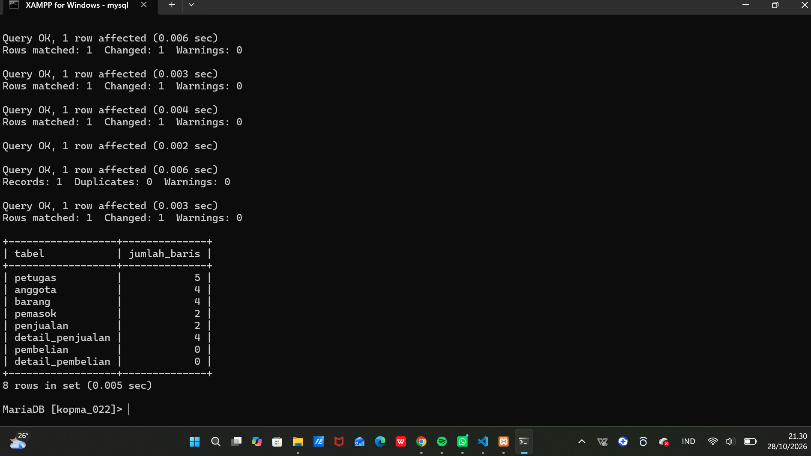

### D.3 Mengubah dan menghapus dengan aman
| Percobaan | Hasil |
|---|---|
| Naikkan harga tanpa WHERE di mode aman | Ditolak, ERROR 1175 |
| Naikkan harga ATK dengan `WHERE kategori_barang = 'ATK' AND id_barang > 0` | Diterima; ATK-001 menjadi 4400, ATK-002 menjadi 7150 |
| Harga di nota PJ-2609-0142 setelah kenaikan | Tetap 4000 dan 6500 |
| Hapus nota uji PJ-2609-0143 | Detail nota: 1 baris sebelum, 0 baris sesudah (CASCADE) |
| Hapus petugas Rina yang pernah melayani | Ditolak, ERROR 1451 |

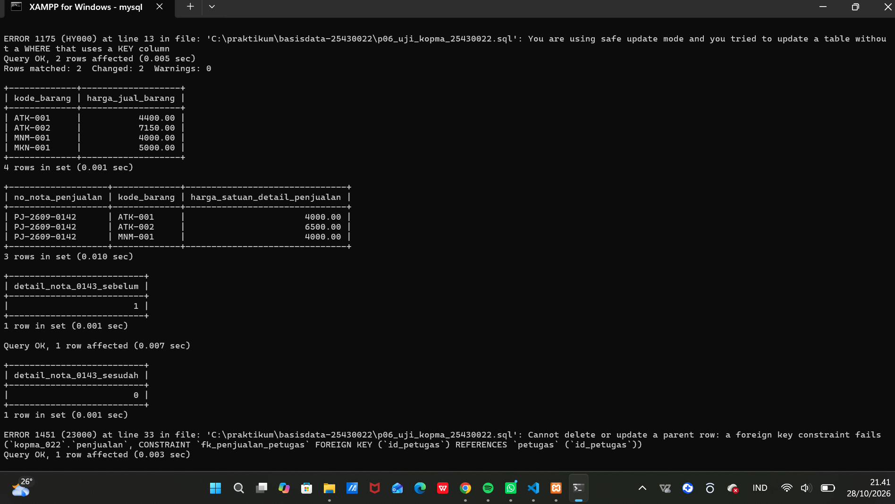

### D.4 Skenario uji
Sembilan skenario dijalankan. Delapan berstatus LULUS, dan satu sengaja GAGAL (UJ-09). Tabel lengkapnya ada di `p06_uji_kopma_25430022.md`.

| Kode | Masukan | Harapan | Hasil nyata | Status |
|---|---|---|---|---|
| UJ-01 | Nota dengan anggota aktif | Diterima | Diterima | LULUS |
| UJ-02 | Nota tanpa anggota | Diterima, id_anggota NULL | Diterima, NULL | LULUS |
| UJ-03 | Stok menjadi -5 | ERROR 4025 | ERROR 4025 ck_barang_stok | LULUS |
| UJ-04 | Nomor nota kembar | ERROR 1062 | ERROR 1062 | LULUS |
| UJ-05 | Detail qty 0 | ERROR 4025 | ERROR 4025 ck_detail_qty | LULUS |
| UJ-06 | NIM kembar | ERROR 1062 | ERROR 1062 | LULUS |
| UJ-07 | Petugas tidak dikenal | ERROR 1452 | ERROR 1452 | LULUS |
| UJ-08 | DELETE tanpa WHERE di mode aman | ERROR 1175 | ERROR 1175 | LULUS |
| UJ-09 | Qty 500 padahal stok 117 | Ditolak | Diterima | **GAGAL** |

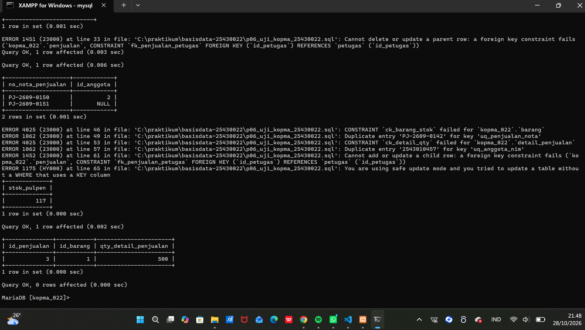

Skrip DDL dan data dijalankan ulang dari awal, dan jumlah baris per tabel kembali sama.

## 4. Jawaban Titik Analisis
**Titik Analisis 1: mengapa INSERT ... SELECT lebih aman daripada mengetik 4000?**
Dengan INSERT ... SELECT, harga diambil langsung dari tabel barang, jadi tidak ada risiko salah ketik atau memakai harga yang sudah tidak berlaku. Nilai yang tersimpan juga pasti sama dengan harga jual pada saat transaksi, sesuai AB-04. Setelah harga pulpen naik, nota PJ-2609-0142 **tidak ikut berubah**. Hal ini terbukti di langkah D.3: harga ATK di tabel barang sudah naik menjadi 4400, tetapi harga di detail nota tetap 4000, karena harga itu disalin ke kolom `harga_satuan_detail_penjualan`, bukan dibaca ulang dari tabel barang.

**Titik Analisis 2: mengapa menghapus nota menghapus detailnya, tetapi menghapus petugas ditolak?**
Di Modul 5, `fk_detail_penjualan` dibuat dengan `ON DELETE CASCADE`, sehingga saat nota dihapus, server otomatis menghapus baris detailnya. Sebaliknya, `fk_penjualan_petugas` memakai aturan bawaan (RESTRICT), sehingga server menolak menghapus petugas yang masih dirujuk oleh penjualan (ERROR 1451). Jika seorang kasir berhenti bekerja, datanya **tidak boleh dihapus**, karena menjadi jejak siapa yang melayani nota-nota lama. Cara yang benar adalah mengunci akunnya dan mencabut hak aksesnya (Pertemuan 13), sementara barisnya tetap disimpan sebagai riwayat.

**Titik Analisis 3: satu uji yang diperkirakan gagal**
Saya menulis UJ-09: menjual 500 pulpen padahal stoknya hanya 117. Menurut AB-03, penjualan seperti ini harus ditolak, tetapi kenyataannya **diterima**. CHECK `ck_barang_stok` hanya memeriksa nilai `stok_barang` di baris tabel barang. Saat baris baru masuk ke `detail_penjualan`, server tidak memeriksa stok di tabel barang, karena CHECK tidak bisa membaca tabel lain. Aturan ini baru bisa dijaga jika penyisipan detail dan pengurangan stok dilakukan dalam satu transaksi, yang akan dibahas di Modul 14.

## 5. Hasil Latihan dan Modifikasi
Berkas: `p06_latihan_kopma_25430022.sql`

### Latihan E.1: arsip anggota nonaktif
```sql
CREATE TABLE anggota_arsip LIKE anggota;

INSERT INTO anggota_arsip
SELECT a.* FROM anggota a
WHERE a.status_anggota = 'nonaktif'
  AND a.tgl_daftar_anggota < '2025-01-01'
  AND NOT EXISTS (SELECT 1 FROM penjualan p WHERE p.id_anggota = a.id_anggota);

DELETE FROM anggota
WHERE id_anggota IN (SELECT id_anggota FROM anggota_arsip)
  AND id_anggota > 0;
```
Ada dua anggota nonaktif yang mendaftar sebelum 2025: Hendra Wijaya (tanpa nota) dan Rahmat Hidayat (punya 1 nota). Hanya **Hendra** yang dipindah ke `anggota_arsip`. **Rahmat tetap ada** di tabel anggota karena syarat `NOT EXISTS` mengecualikan anggota yang masih punya penjualan. Kalau Rahmat dihapus, FK `fk_penjualan_anggota` juga akan menolaknya.

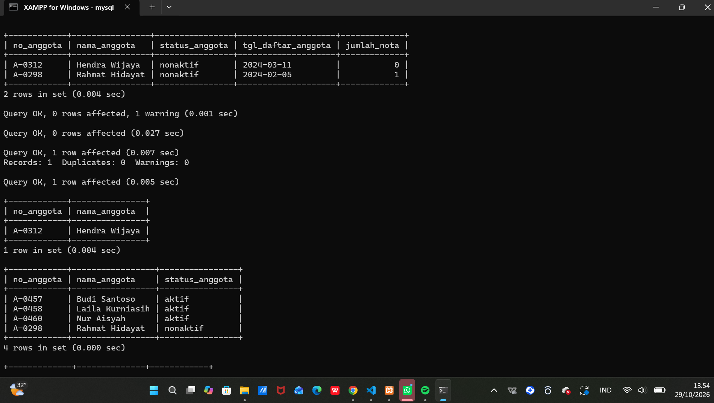

### Latihan E.2: harga makanan naik 5%, dibulatkan ke ratusan
```sql
UPDATE barang
SET harga_jual_barang = ROUND(harga_jual_barang * 1.05, -2)
WHERE kategori_barang = 'makanan' AND id_barang > 0;
```
Harga Roti Cokelat berubah dari 5000 menjadi **5300** (5000 × 1,05 = 5250, lalu dibulatkan ke ratusan terdekat). Angka `-2` pada ROUND berarti pembulatan dilakukan dua digit di sebelah kiri koma, yaitu ke ratusan.

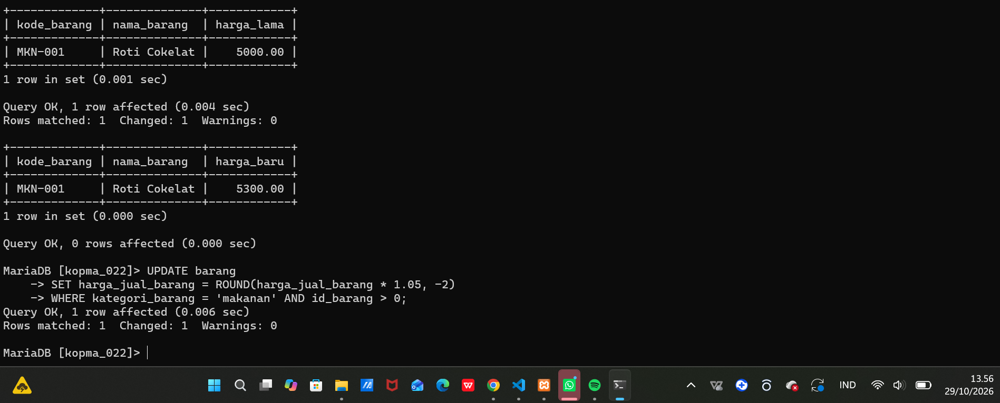

## 6. Tugas Mandiri: Milestone Proyek 06
Proyek: **Perpustakaan Cendekia WFR** (basis data `perpus_022`, akun `dev_022`, P = 5)

| Berkas | Isi |
|---|---|
| `p06_data_25430022.sql` | Data sampel proyek |
| `p06_uji_25430022.sql` | Skrip 14 skenario uji |
| `p06_uji_25430022.md` | Tabel skenario uji dan utang desain |

### 6.1 Data sampel berbasis parameter P
| Tabel | Jumlah baris | Syarat buku |
|---|---|---|
| petugas | 5 | induk minimal 5 ✔ |
| anggota | 12 | induk minimal 5 ✔ |
| buku | 15 | induk minimal 5 ✔ |
| eksemplar | 35 | induk minimal 5 ✔ |
| peminjaman | **50** | transaksi utama minimal 10 × P = 50 ✔ |
| detail_peminjaman | 79 | 1 sampai 3 eksemplar per slip |

Peminjaman tersebar pada **8 tanggal** (1, 5, 8, 12, 15, 19, 22, dan 26 Oktober 2026), memenuhi syarat minimal tiga tanggal. Data dibuat realistis:
- tidak ada eksemplar yang dipinjam dua orang sekaligus;
- semua peminjam berstatus aktif;
- denda selalu kelipatan Rp5.000 dan hanya ada untuk buku yang sudah kembali;
- ada pinjaman yang terlambat dan belum kembali, sebagai bahan KI-04.

Semua kunci tamu diisi lewat kode alami memakai `INSERT ... SELECT ... JOIN`, sehingga tidak bergantung pada tebakan nilai id.

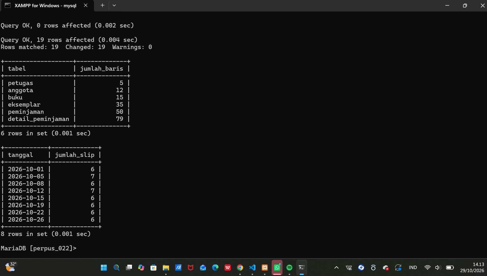

### 6.2 Skenario uji
Ada 14 skenario: 3 positif dan 11 negatif. 12 berstatus LULUS dan 2 GAGAL.

| Kode | Masukan | Hasil nyata | Status | Aturan |
|---|---|---|---|---|
| UJ-01 | Slip baru oleh anggota aktif | Diterima | LULUS | AB-01, AB-02 |
| UJ-02 | Pengembalian tepat waktu, denda 0 | Diterima | LULUS | AB-06 |
| UJ-03 | Terlambat 3 hari, denda 15.000 | Diterima | LULUS | ck_detail_denda_p |
| UJ-04 | Nomor slip kembar | ERROR 1062 | LULUS | AB-01 |
| UJ-05 | NIM kembar | ERROR 1062 | LULUS | AB-04 |
| UJ-06 | Anggota tidak terdaftar | ERROR 1452 | LULUS | AB-07 |
| UJ-07 | Denda 7.500 | ERROR 4025 | LULUS | AB-06 (berbasis P) |
| UJ-08 | Denda padahal belum kembali | ERROR 4025 | LULUS | AB-06 |
| UJ-09 | Jatuh tempo sebelum tanggal pinjam | ERROR 4025 | LULUS | ck_peminjaman_tempo |
| UJ-10 | Status eksemplar di luar ENUM | ERROR 1265 | LULUS | AB-08 |
| UJ-11 | Hapus buku yang punya eksemplar | ERROR 1451 | LULUS | fk_eksemplar_buku |
| UJ-12 | UPDATE tanpa WHERE di mode aman | ERROR 1175 | LULUS | kebijakan lab |
| UJ-13 | 8 eksemplar dalam satu slip | Diterima | **GAGAL** | AB-05 |
| UJ-14 | Peminjaman oleh anggota nonaktif | Diterima | **GAGAL** | AB-02 |

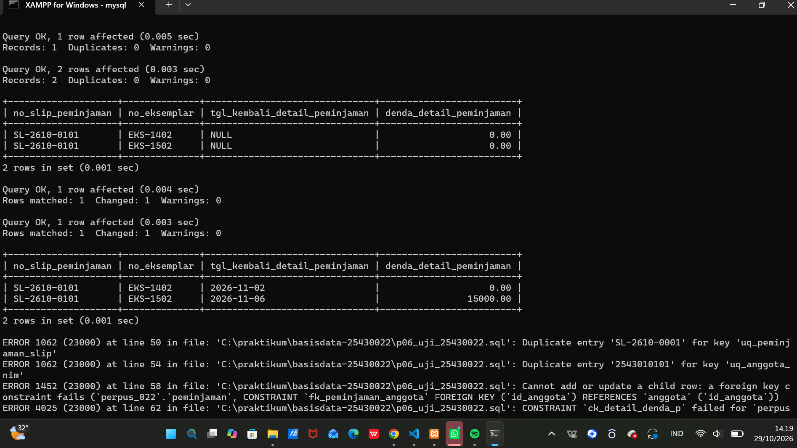
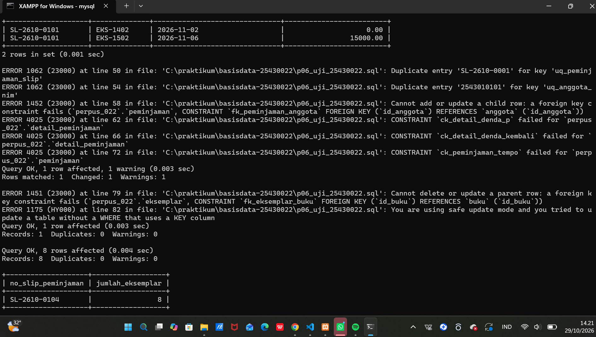
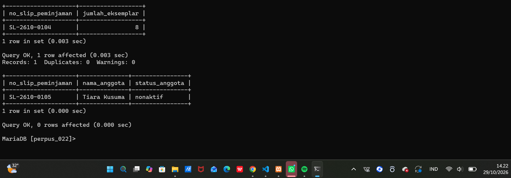

### 6.3 Utang desain untuk Modul 14
- **UJ-13 (AB-05):** batas P + 2 = 7 eksemplar per slip menyangkut **jumlah baris**, sedangkan CHECK hanya memeriksa satu baris.
- **UJ-14 (AB-02):** status anggota ada di **tabel lain**, dan CHECK tidak boleh membaca tabel lain.

Keduanya akan dijaga dengan memeriksa aturan di dalam transaksi peminjaman, lalu membatalkannya (ROLLBACK) jika melanggar.

### 6.4 Bukti dapat dijalankan ulang
Setelah skrip uji dijalankan, tabel peminjaman berisi 53 baris karena ada slip tambahan dari uji. Setelah DDL dan data dijalankan ulang, jumlahnya kembali menjadi **50**, dan slip uji (SL-2610-0101, 0104, 0105) tidak ada lagi.

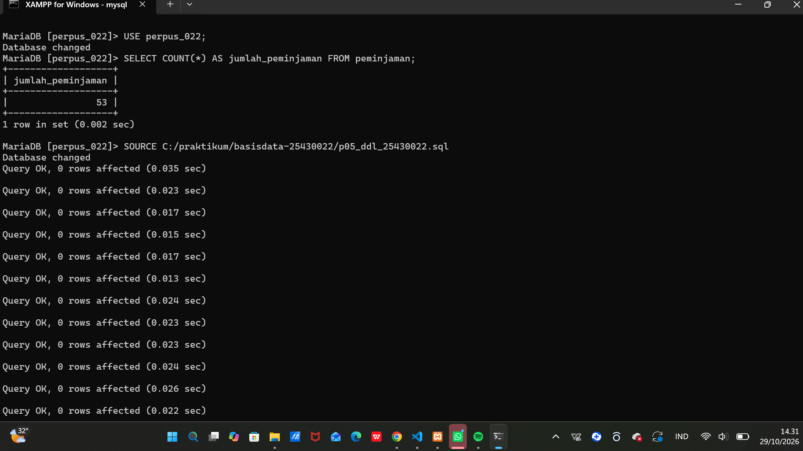
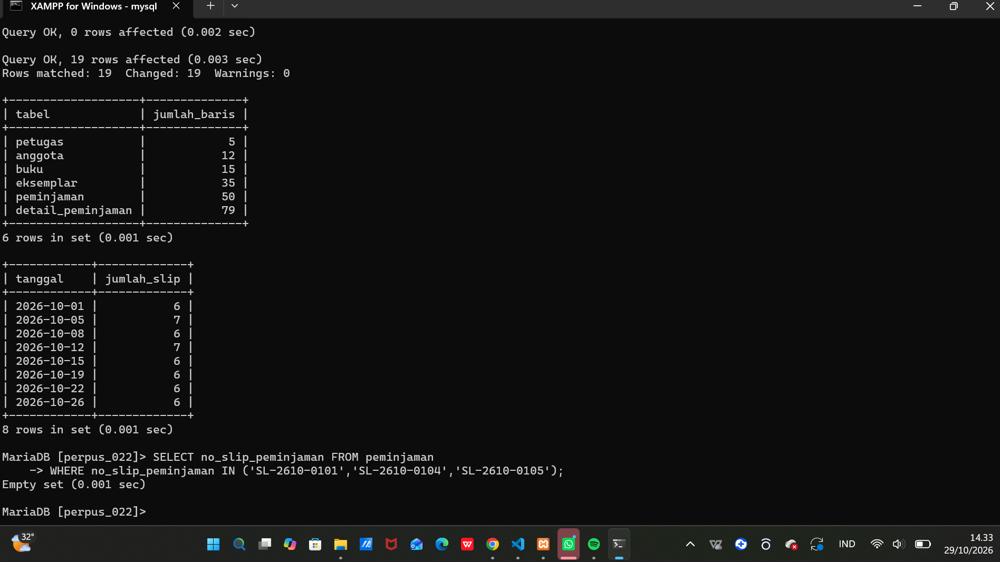

## 7. Pembahasan dan Kendala
1. **Berkas `.md` tidak ikut ter-push.** Commit `p06: data dan uji kopma` hanya berisi dua berkas `.sql`, sedangkan `p06_uji_kopma_25430022.md` tidak muncul di GitHub. Saya mengecek dengan `dir` dan `git status`, lalu menambahkan berkas itu secara terpisah dengan `git add`, commit, dan push. Pelajarannya: setelah commit, saya perlu memeriksa baris ringkasan `... files changed` dan mengecek GitHub.
2. **Mode aman menolak DELETE dengan subquery.** Pada latihan E.1, perintah `DELETE FROM anggota WHERE id_anggota IN (SELECT ...)` ditolak dengan ERROR 1175, karena mode aman tidak menganggap syarat `IN (subquery)` sebagai syarat kolom kunci. Saya menambahkan `AND id_anggota > 0` agar syaratnya memakai kolom kunci secara langsung, tanpa mematikan mode aman.
3. **ERROR 1062 saat skrip uji dijalankan dua kali.** Skrip uji menambah data (nota dan slip baru). Jika dijalankan lagi tanpa membangun ulang tabel, nomor nota atau slip yang sama ditolak. Solusinya adalah selalu menjalankan DDL lalu data sebelum menjalankan uji lagi.

## 8. Kesimpulan
Dari praktikum ini saya belajar mengisi data dengan urutan yang benar dan mengubah data dengan aman, karena mode aman benar-benar mencegah UPDATE atau DELETE yang tidak sengaja mengenai semua baris. Skenario uji membuat saya bisa membuktikan, bukan hanya mengira, bahwa data salah memang ditolak server. Saya juga menemukan bahwa aturan seperti batas 7 eksemplar per slip dan peminjam harus aktif belum bisa dijaga constraint, sehingga harus diselesaikan dengan transaksi di Modul 14.

## 9. Pernyataan Penggunaan AI
Alat: Claude (Anthropic)
Claude saya gunakan untuk menyusun draf skrip data sampel dan skrip uji (Kopma dan proyek) berdasarkan DDL dan aturan bisnis saya, menjelaskan pesan galat yang saya temui. Menjalankan skrip di MariaDB, mencocokkan hasil nyata dengan layar.

## 10. Bukti Git
- Repositori: https://github.com/whyfadlurohman-lab/basisdata-25430022

| No | Pesan commit | Hash |
|---|---|---|
| 1 | `p06: data dan uji kopma` | 2c71c61 |
| 2 | `p06: skenario uji kopma` | df29332 |
| 3 | `p06: screenshot data dan uji kopma` | c8875ed |
| 4 | `p06: latihan e kopma` | 815f999 |
| 5 | `p06: milestone proyek 6 data dan uji` | 4963c2c |
| 6 | `p06: screenshot data dan uji proyek` | 6341b41 |
| 7 | `p06: laporan pertemuan 6` | 258eb61 |

## Checklist
**Tabel 6.2 Checklist khusus laporan Pertemuan 6**
| Status | Jenis | Yang harus ada |
|:---:|---|---|
| ✅ | Berkas wajib | `p06_data_25430022.sql` (data sampel berbasis parameter P) dan `p06_uji_25430022.md` (skenario uji) |
| ✅ | Bukti tangkapan layar | Hasil skenario uji positif dan negatif; jumlah baris per tabel |
| ✅ | Analisis wajib | Tabel skenario uji: masukan, hasil yang diharapkan, hasil nyata, status |

**Tabel P.13 Checklist umum laporan praktikum**
| Status | Butir | Yang harus ada |
|:---:|---|---|
| ✅ | Identitas | Nama, NIM, kelas, pertemuan ke-N, tanggal pelaksanaan, nama asisten/dosen |
| ✅ | Tujuan | Tujuan praktikum ditulis ulang dengan bahasa sendiri (maksimal 5 baris) |
| ✅ | Ringkasan teori | Pemahaman sendiri atas Dasar Teori, maksimal setengah halaman, tanpa menyalin buku |
| ✅ | Langkah percobaan (D) | Tangkapan layar hasil langkah kunci sesuai checklist khusus, masing-masing diberi keterangan singkat |
| ✅ | Titik Analisis | Semua Titik Analisis dijawab lengkap dengan alasan, bukan sekadar ya/tidak |
| ✅ | Latihan (E) | Skrip/dokumen hasil latihan beserta bukti berjalan |
| ✅ | Tugas Mandiri (F) | Milestone proyek pertemuan ini: berkas, bukti, dan penjelasan keputusan desain |
| ✅ | Pembahasan dan kendala | Galat yang ditemui, cara membacanya, dan cara mengatasinya |
| ✅ | Kesimpulan | Dua sampai empat kalimat dengan bahasa sendiri |
| ✅ | Pernyataan Penggunaan AI | Alat yang dipakai, untuk apa, bagian mana; tulis "tidak menggunakan" bila tidak memakai |
| ✅ | Bukti Git | Tautan repositori dan kode commit (hash) pertemuan ini dengan pesan pNN: ... |
| ✅ | Keaslian | Setiap tangkapan layar memperlihatkan akun ber-NIM dan jam sistem; nama objek memuat NIM/inisial |